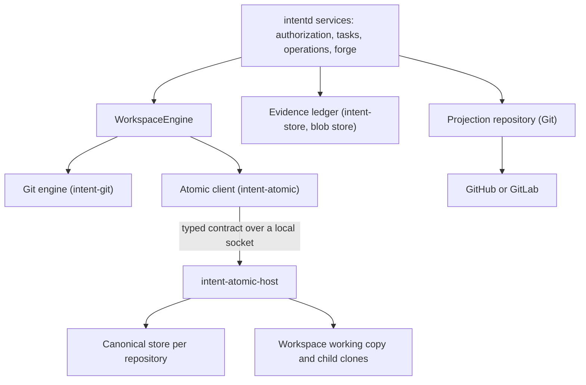
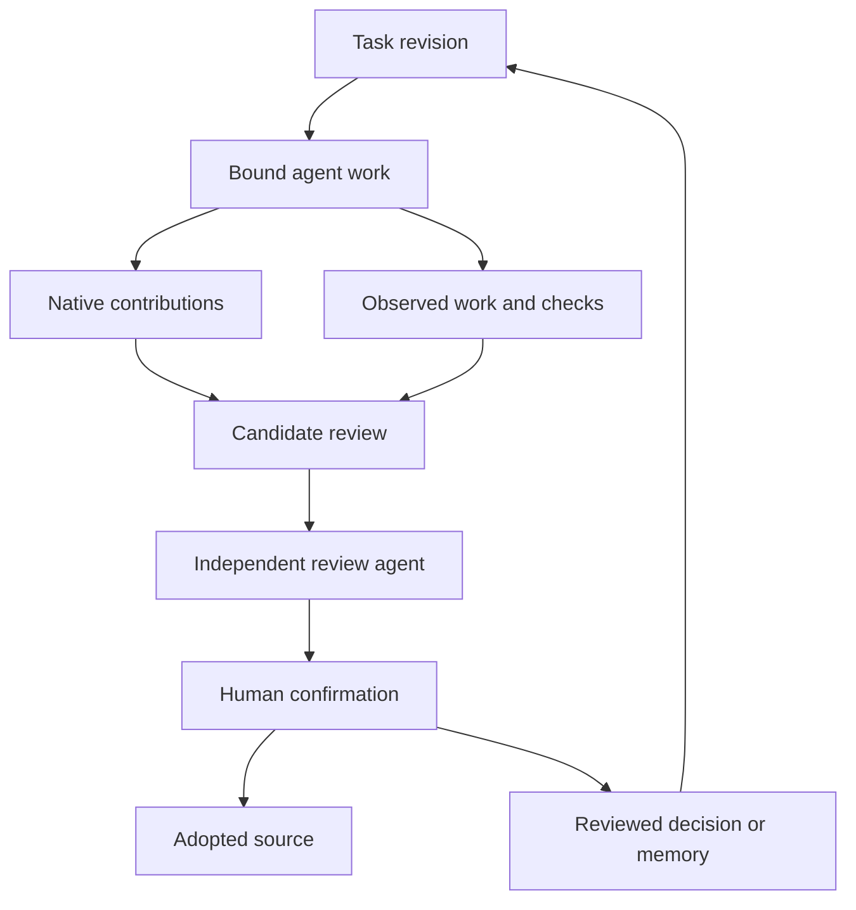

# Atomic as Intent's change and work-evidence substrate: plan

Status: implementation in progress; delivery refactored around executable T1–T5 tracers on 2026-11-15. See [delivery](#12-delivery), the [coverage map](atomic-substrate-delivery-map.json) and [implementation status](atomic-substrate-status.md). The full rollout remains unqualified.

- **Pins observed:** intentd `c755f03` (v0.11.197), cloudlands-fe `db83827`, protocol 18.0,
  Atomic `bf9893adb57dccbaa8f7e14277e02d060d74bf53` (tag `v0.22.1`, 2026-11-13), which is also
  the tip of upstream's development branch and the CLI installed on the planning machine.
- **Pin history:** the Atomic facts were first read at `v0.22.0` (`61d8040`). The only source
  change in `v0.22.1` is in `atomic-repository/src/repository/insert.rs`: an inserted change is
  now verified against its stored bytes, because re-encoding a change recorded before 0.20
  gives a different hash. No dependency or toolchain changed. Every other citation was
  unaffected; the one line number that moved is updated.
- **Paths:** intentd paths are relative to `packages/intentd/crates/` unless shown otherwise.
  Frontend paths are relative to `packages/cloudlands-fe/src/`. Atomic paths are relative to the
  Atomic repository root at the pin.
- **Inputs:** this plan merges two earlier drafts: the substrate draft (Atomic crates, task →
  change → confirm) and `docs/plans/atomic-vcs-replacement-2026-11-12.md` (bundled CLI, hooks,
  Git retirement). The reasoning for each merge choice is in
  `docs/reviews/atomic-substrate-plan-review-2026-11-12.md`.
- **Index labels:** `D` is a decision (section 3), `A` an assumption to validate (section 14),
  `W` a work item (section 13), `V` a verification case (section 15). Requirement lists inside a
  section carry a short prefix, for example `REC-2`.

## Terms

| Term | Meaning in this plan |
|---|---|
| Canonical store | The Atomic database for one repository on one node. It holds changes, views and the knowledge graph. |
| Host | The `intent-atomic-host` process. It is the only process that opens a canonical store. |
| View | Atomic's replacement for a branch: an ordered set of changes. |
| Working copy | A directory on disk bound to one view. |
| Baseline | A view that Intent never changes after creating it. Work starts from one. |
| Contribution | The changes one agent turn or one human record produced. |
| Closure | A set of changes plus every change they depend on. |
| Candidate | A private composition of a baseline, selected contributions and the current target, offered for review. |
| Materialization | The exact file tree (paths, kinds, modes, content) a native state produces. |
| Projection | A Git commit built from a materialization so a forge can host it. |
| Receipt | A durable record that one effect happened, with the identities it applied to. |
| Evidence ledger | Intent-owned storage for task revisions, context, observations, checks and decisions. |

---

## 1. Goal and scope

Give every piece of agent work a connected, queryable record: what was asked, which definition
governed the work, what changed, what supports the result, who accepted it, and what later work
should learn from it. The task → change → confirm loop is the main product surface. Atomic
supplies the native change graph, intents, triage, query, provenance and memory. Intent keeps
authority over task text, assignment, permissions, scheduling, human decisions and publication.

In scope: Intent's repository and agent workflow architecture, for workspaces that qualify.

Out of scope: changing the version control used to develop the Intent repositories themselves.

The benefits to demonstrate, against today's Git workflow: faster understanding and review of
agent work, less repeated discovery, clearer coordination between agents, reliable composition
of parallel work, and lower cost per accepted task.

## 2. Summary

**What gets built.**

1. An engine boundary (`WorkspaceEngine`) with a Git implementation that preserves today's
   behaviour and an Atomic implementation.
2. An owned host process that links Atomic at the pin and is the only opener of each canonical
   store. intentd talks to it over a typed, versioned contract.
3. An engine-neutral evidence ledger and a `task.confirm` action, so a decision binds an exact
   task revision to an exact candidate and its evidence.
4. A read-only knowledge layer (code search, entity index, change impact, related work,
   context) that works on existing Git workspaces.
5. Atomic workspaces: a workspace working copy for the user and the primary agent, warm private
   clones for concurrent agents, every turn recorded, exact composition, native triage,
   independent review by a second agent, and a verified Git projection for the forge.

**Delivery order.** Section 12 now controls execution through observable scenarios:

1. T1: one real Git task feeds the actual Atomic query engine and survives clean restart.
2. T2: the same fixture exercises native Atomic writing, record/checkpoint and interrupted recovery.
3. T3: qualified Git-first then native review, human confirmation, adoption and rewind.
4. T4: parallel agents, composition/conflicts, tools, fan-out and memory follow-up.
5. T5: full qualification, publication, ordinary activation/UI and the retained measured pilot.
6. POST: separately qualified increments, conversion and the unchanged retirement gate.

T1 needs no Atomic authority over source. Early native scenarios are disposable developer
profiles; ordinary Atomic workspace admission retains the complete safety/recording bundle.
Each scenario reuses existing components and closes only its stated assertions. Original
W-item completion, V-case qualification and production/pilot gates remain distinct.

**Latency is a gate, not a follow-up.** Section 5.11 sets a budget for every interaction (for
example 100 ms from an agent's edit to the changes panel, 200 ms to open a review) and the rules
that meet them: push instead of poll, optimistic mutations fenced by a state token, Intent's own
read model in front of the host, and heavy work precomputed before anyone asks. The push path
and the measurement harness land with the seam and benefit Git workspaces too.

Disposable tracers capture timings from their first run. Full reference-machine, repository-size
and p95 qualification remains a production/pilot gate in T5; it does not precede the first
correctness demonstration. The original budgets are unchanged.

**What the first Atomic release excludes** (refused at create time or call time, D17): remote
placement, submodules and gitlinks, secondary roots, LFS, Windows, GitLab qualified native
review, plain folders, partial-hunk selection, delegation from a dirty parent, and adoption into
a dirty target.

## 3. Decisions

"Confirmed" marks a decision that changed or settled something recorded in an earlier draft and
was accepted on 2026-11-13, including the two added that day (D18, D19). "Subject to" names the
assumption whose validation could still overturn it.

| # | Decision | Why | Status |
|---|---|---|---|
| D1 | Atomic is the native representation of agent contributions, their dependencies and the linked intent and evidence, for qualified workspaces. Intent stays the authority for tasks, permissions, scheduling, human decisions and publication. | Atomic's intent graph, triage and query are where its value is. A graph edge or a native `done` field must never decide a task's status. | Decided |
| D2 | Atomic runs in an owned host process, not linked into intentd and not driven through CLI output. | Linking is expected to fail dependency resolution and changes intentd's build (section 5.1). CLI output cannot give exact change bytes or idempotent recording. | Confirmed, subject to A1 |
| D3 | Intent is the only recorder. Atomic's agent hooks are not used. Tool-level provenance comes from Intent's ACP events, classified by Atomic's own classifier. | One process holds the store, so hook processes cannot write to it. ACP covers every provider with no per-provider hook injection and no gap-filling. | Confirmed (reverses "hooks primary") |
| D4 | On Atomic workspaces every settled turn is recorded, including cancelled and failed ones. `git.autoCommit` does not apply there. | Records are local and published deliberately. A boundary at every turn makes rewind and fork exact. | Decided (carried over) |
| D5 | Agent working directories contain no Git repository. Git projection lives in a separate daemon-owned repository. | Two mutable histories in one directory diverge silently. | Decided (carried over) |
| D6 | One canonical store per repository per node, shared by that repository's workspaces. | Intents, memories and the knowledge graph only help later work if they span workspaces. With one host process there are no cross-process writers. | Confirmed |
| D7 | The workspace root is the working copy of the workspace view. The user and the primary agent work there. Every other concurrent agent gets a warm private clone. | Keeps today's experience for the common single-agent case and keeps build caches for children. | Confirmed (see Q1) |
| D8 | Local isolation and the capture barrier are built in the Atomic path. They do not wait for the node boundary. | The head/node split, node link and writer barrier are documented as prepared and are not implemented. | Decided |
| D9 | The evidence ledger and `task.confirm` are engine-neutral and land on Git workspaces first. | De-risks the product half, and produces the baseline measurements the comparison needs. | Decided |
| D10 | The knowledge layer ships read-only on Git workspaces before any Atomic workspace exists. | A derived, rebuildable index has no authority over source, so none of the recovery gates apply. | Decided |
| D11 | The engine is fixed per workspace root at creation. Only new workspaces can be Atomic until conversion is separately qualified. | Per-workspace isolation and rollback. | Decided |
| D12 | Legacy `git.*`, `gitRoot.*` and SHA fields keep Git meaning. On an Atomic root they return a typed unsupported-backend error. No Git-shaped projection of Atomic data is built. | An Atomic hash must never appear as `commitHash`. A projection layer would be written only to be deleted. | Decided |
| D13 | Intent builds projection commits itself from a verified materialization. It does not use `atomic git push` or the Git bridge. | The bridge is a proposed RFC and Unix-only. A fixed parent and verified tree avoid its ref reconciliation. | Decided |
| D14 | Retiring the Git editing backend remains the end state, behind an explicit retirement gate, and is off the pilot's critical path. A Git engine stays for secondary roots and submodules. | Submodule repositories are Git repositories on the forge. Retirement must not strand any workspace. | Confirmed |
| D15 | Independent review is a delegated agent on a different model or provider from every author of the candidate. Human confirmation is a separate, authenticated Intent decision. | Atomic's own independence check is a string comparison. Intent can supply a real separate execution. | Decided |
| D16 | The pilot signs work and review intents with local Ed25519 keys in a daemon-scoped Atomic identity directory. The user's own Atomic configuration is never read or written. | Atomic's canonical gate requires authorship and a proof. External custody and delegated credentials come later. | Decided (see Q2) |
| D17 | The exclusions listed in section 2 are refused, not silently degraded. | Each depends on unfinished Atomic or Intent work. | Decided |
| D18 | Agents use the pinned `atomic` CLI inside their working copy. It reaches the host through Atomic's sandbox ingress under a per-assignment grant, so the upstream Atomic skills run unmodified. The grant withholds recording and view changes. | Atomic already builds this path: a CLI in a sandbox submits to its owner over a socket. Rewriting six skills around custom bindings would drift from upstream. | Confirmed, subject to A33 |
| D19 | Interactive state is pushed as a snapshot plus deltas from Intent's own read model. The host is never on an interactive read path. The latency budgets in section 5.11 are exit gates. | Atomic status costs O(tracked files) and every Atomic handler waits behind one lock. Today's changes loop takes 1.3 to 2.5 s to reach the panel. | Confirmed |

---

## 4. Current state

### 4.1 Contracts that stay binding

| Area | Existing behaviour that must be preserved |
|---|---|
| Commit selection | Explicit files, a human-requested commit of the existing index, actor-attributed dirty paths, and refusal on missing attribution are four distinct modes. |
| Auto-commit | Workspace policy applies before recording. `auto_commit.rs` classifies failures by matching message text (lines 374-377); both ends change together when this moves to typed outcomes. It acts only on normal finish reasons (line 83). |
| Discard | Git discard restores worktree paths from the index and keeps staged content. It is distinct from excluding or compensating for a recorded change. |
| Attribution | `tracked_changes` rows are audit observations. `PathState::Unknown` stays conservative: unreadable ownership never becomes "clean". |
| Review | Qualified preparation binds the original caller, connection, root, command, selected source and configuration. Completed primitives survive later failures. Qualified native review supports GitLab only. |
| Forge status | Git ancestry, forge-required updates, checks, reviews, conflicts and unknown observations stay separate facts. |
| Workspace layout | `checkoutMode` values `worktree`, `cow` and `direct` are immutable. Engine and physical layout are separate concepts. |
| Plain folders | `plainFolder` is immutable. A later `.git` or `.atomic` does not convert it. Delete and archive never remove user folder contents. |
| Reads | Bounded diff packing (480,000-byte budget), lazy content reads, metadata-only history, root-scoped authorization. |
| Deletion | Stop admission and writers, retain recoverable work, tombstone ownership, then clean up. |
| Checkpoints | `intent-git/src/checkpoint/mod.rs` captures immutable Git objects without moving the branch or index, requires the caller to quiesce writers, and restores into a new private checkout. Format 1 stays readable. |

### 4.2 What exists in Intent, and what does not

| Concern | State at the pins |
|---|---|
| VCS seam | None. `intent_git::` is used on 540 lines in 78 files outside `intent-git`; `git2::` on 393 lines in 56 files. `SourceControl` (`intent-sourcecontrol/src/lib.rs:74`) is the forge interface and stays as is. |
| Tasks | A task is a note with `TaskMetadata` in `note.task_json` (`intent-core/src/model.rs:1900-1945`). `rev` is a write counter. `acceptance_criteria` is `Vec<String>`. Statuses include `in_progress`, `review_required` and `complete`. |
| Task revisions | `note_version` keeps the newest 50 title and content snapshots with no digest and without `task_json`. There is no immutable revision. |
| Confirmation | No confirm or accept action for tasks. `review_required` is set by `agent.reportToParent` (`intent-services/src/agent_ops.rs:13031`); `complete` by the generic `task.updateNoteStatus`. |
| Dispatch | `agent_create_op` (admission at `agent_ops.rs:6059-6100`), `agent_delegate_op` (13731), `agent_wake_or_create_op` (17306); turns start through `agent_manager.rs` `acquire_turn_start` (2200) and `try_begin_turn` (10651). There is no pre-dispatch gate abstraction. |
| Completion | `deliver_completion_to_watches` (`intent-services/src/lib.rs:9115`), `agent_subscriptions.rs` (`CompletionWatch`, `DelegationGroup` with `after_all`). |
| Isolation | Local agents in a workspace share one worktree. Per-agent sandboxes were dropped (migration `0187`). Local placement rejects a `checkout` (`intent-core/src/placement.rs:235-249`). Isolated checkouts exist only on remote and cloud machines. |
| Node boundary | The head/node split, node link and checkpoint format are "prepared… not implemented" (`docs/ARCHITECTURE.md:122-147`). No writer-barrier type exists in code. |
| Context | `intent-context` is an auggie-backed `ContextEngine`. `intent-search` is ripgrep. Prompt assembly is in `intent-services/src/rules.rs:589-742`. `workspace.getContext` payloads are opaque frontend JSON. |
| Memory | No memory service or RPC. |
| Usage | Token usage is persisted (`agent_session.rs:6213`, `usage_stats_repo.rs`). There is no cost store. |
| Store | Newest migration is `0190`. No transactional outbox, no blob store. `intent-store` refuses a database whose migration ledger is newer than the build (`intent-store/src/lib.rs:461-485`). |
| Capabilities | A static object plus runtime additions in `with_runtime_capabilities` (`intent-transport/src/client.rs:118-170`). |
| Frontend | `GitClient` at `lib/client/app-client.ts:1629`. No conflict-resolution UI, no task confirmation or criteria UI. Labs flags are entries in `shared/app-settings-schema.ts:234-300`. |
| Toolchain | intentd pins Rust 1.96.0 (`rust-version` 1.88) and ships macOS, Linux and Windows targets. Sidecars are bundled through `electron-builder.yml` `extraResources`. |

### 4.3 Atomic at the pin

Read from source; nothing was built or run.

| Capability | Where | State and limits |
|---|---|---|
| Views | `atomic-repository/src/repository/views.rs` | A draft view shows its own changes plus its live parent's full set. `create_view_from` does not freeze the parent. There is no frozen view; the nearest aids are tags and `(view, sequence, state)` pins. |
| Store ownership | `libatomic/src/daemon/state.rs:71-75` | Handle identity is a digest of the working-root path. Two sandbox roots get two serialization gates over one database. redb permits one open handle. |
| Recording | `record/options.rs:255,262`; `record/assemble.rs:385`; `repository/changes.rs:195`; `repository/insert.rs:2420` | Save and apply can be disabled, exact bytes are available, and bytes can be imported and inserted separately. Ordinary ingress is a plain file write with no fsync (`changes.rs:331`). Request replay detection is declared and not implemented. |
| Merge | `atomic-core/src/merge/` | Token-level three-way merge with a generic lexer, no syntax tree. The property test generates random line edits. |
| Conflicts | `repository/conflict_object.rs` | Content-addressed conflict sets with restore verification. Tested. |
| Intents | `atomic-repository/src/intent_graph.rs`; `atomic-canonical/src/{gate,proof,node}.rs` | Directive-based intents with criteria, scope and constraints; a validation gate; Ed25519 Data Integrity proofs; a substance hash. Creation allocates a new identifier on every call (`repository/vault_intent.rs:141`). |
| Turn binding | `atomic-agent/src/turn/session.rs:776-856` | One governing intent per turn, frozen at record start. Its only caller is the CLI. |
| Triage | `atomic-repository/src/triage/`; `libatomic/src/daemon/services_triage.rs` | Candidate sets and a review report with versioned payloads. The outer `candidates`, `layers` and `risks` arrays are empty placeholders. Reviewer independence is a string inequality with no signature check. The triage reference hashes pins only, not the report. |
| Query | `atomic-repository/src/query_plan.rs` | Steps: graph search, typed neighbours, vector search, content read, filter, patch evidence. Only some steps honour a view. No cursors. |
| Code structure | `atomic-semantic/`; `libatomic/src/daemon/change_impact.rs` | Tree-sitter entities for TypeScript, Python, Rust, Go, Java, C, C++ and Swift. Svelte is absent. Impact is capped at 2000 files and 30 callers. |
| Provenance | `atomic-agent/src/provenance/classify.rs:15-19`; `libatomic/src/daemon/services_agent.rs` | Tool calls classified as exploration, commitment or verification. Journal handlers have bodies; the generic read handler is a stub. |
| Memory and context | `atomic-canonical/src/memory.rs`; upstream docs/vault-context-design.md | Attestable memories of five kinds. Revision-gated pull. View-scoped retrieval is refused. |
| Attestation | `atomic-core/src/change/attestation.rs:1135-1146` | Trust verification rejects session-MAC proofs and verifies configured keys. |
| Delegation and grants | `atomic-canonical/src/delegation.rs`; `libatomic/src/daemon/sandbox_grants.rs` | Delegation certificates; grants that scope one view to a capability subset with an expiry, with the host as authority. Both tested. |
| Recovery | `repository/remote_cache.rs:740`; `views.rs:842,929,1037`; `resurrection.rs:480` | Closure export, ordered view manifests, prefix-resumable exact restore. Private `wc/*` views and snapshot-kind changes are excluded. Conflict-state verification can materialize files. |
| Operations | `repository/operation.rs:785-854` | Undo only at the sole current head; inverses cover view and materialization transitions. |
| Usage | `atomic-repository/src/workflow_usage.rs` | Read-only token and cost summaries. |
| Evidence export | `atomic-canonical/src/provenance_export.rs`; `repository/provenance_gate.rs` | DSSE export with pinned-key verification; a publication gate over provenance. |
| Sandbox images | `atomic-repository/src/oci.rs` | OCI stage and seal with delta layers. Tested. |
| Git interop | `atomic-cli/src/commands/git/` | Fresh import defaults to a first-parent, graph-only stream and is Unix-only. The Git bridge RFC is still "proposed". Binding packs are implemented. |
| Service surface | `libatomic/src/local.rs:91-358` | `LocalService` dispatches 23 of 105 declared RPCs. Triage, sandbox, diff, the turn journal, unrecord, conflicts, preview, intent create/update/validate, project identity and Git interop are not dispatched. |
| Command line at 0.22.1 | `atomic --help` on the installed binary | `sandbox open <view>` mints a grant with `--acting-as`, `--ttl`, `--capability` and writes a pointer (`--dest`); `sandbox renew`, `close` and `materialize --prefix` complete that flow. `intent new` takes `--kind` (feature, review, bug, chore, remediation) and `--review <target>`, and the vault allocates the identifier. `triage review` has `--json`, `--walkthrough`, `--html` and `--attest`. `blame` is line-level. `diff` has `--word-diff` and `--json`. `vault context` retrieves memories for a task. `vault intent` and `vault memory` are removed and redirect to `intent` and `memory` |
| Build | root `Cargo.toml`, `rust-toolchain.toml` | `rust-version` 1.90, toolchain 1.98.0, release profile `panic = "abort"`, Apache-2.0, not on crates.io, 544 packages in the lockfile. Embeddings and model calls go over HTTP to external providers, with a hash fallback. |

### 4.4 Where latency accrues today

Read from source. The Atomic timings are upstream's own published measurements on small
repositories, not ours.

| Hop | Today | Evidence |
|---|---|---|
| Renderer → daemon | Renderer → Electron main (`ipcRenderer.invoke`, structured clone) → newline-delimited JSON over a Unix socket. No streaming responses. No client-side request timing | `lib/client/live/electron-ipc-transport.ts:352-383`; `features/backend/main/json-rpc-client.ts` |
| Daemon → renderer events | A persisted event waits for a single-connection SQLite writer before fan-out. Main forwards every notification to every window, unbatched | `intent-services/src/events/bus.rs:211-292`; `features/backend/main/backend.ipc.ts:2214-2222` |
| File change → changes panel | 300 ms watcher debounce → 1 s refresh window → full libgit2 status walk → push → the frontend waits 1 s → `file-tracking.getChanges`. Roughly 1.3 to 2.5 s plus the walk | `events/watcher.rs:44-61`; `events/git_status_refresher.rs:1-47`; `workspace-lifecycle/sagas/lifecycle-read-saga.ts:678-691` |
| Agent file write | The tool call waits for an event publish, a diff computation and a `tracked_changes` upsert | `intent-acp/src/handler.rs:238-263` |
| Turn end | One global loop handles idle events one at a time, with a model call of up to 60 s | `intent-services/src/auto_commit.rs:207-236` |
| Chat tokens | One event and one store dispatch per chunk, with no frame batching | `agent_session.rs:6589`; `chat-state/sagas/chat-subscribe-saga.ts` |
| Diffs | Requested per file, pages fetched serially, cache keyed by content string (512 entries), sidebar list not virtualized | `file-tracking/components/diff/diff-ipc-batcher.ts`; `sidebar/FileChangesSection.svelte:783` |
| Mutations | `runMutation` is not optimistic; task writes are | `lib/client/live/live-support.ts:118-143`; `features/tasks/tasks-write-service.ts` |
| Reusable | Typed snapshot-plus-delta channels with sequence numbers and resnapshot; single-flight caches; bounded reads | `lib/client/live/delta-subscription.ts`; `git_status_cache.rs` |
| Atomic: every handler | One mutex per repository serializes reads and writes. Each call opens the database (about 50 ms, and it scans every change and view row) | `libatomic/src/daemon/state.rs:35-58`; `atomic-core/src/pristine/txn/pristine.rs:559-596` |
| Atomic: one handle | Inside one handle, read transactions run beside one writer. A shared-handle constructor exists and is unused | `pristine.rs:700-705`; `atomic-repository/src/repository/mod.rs:1043-1047` |
| Atomic: status | O(tracked files) metadata on every call; 0.61 s warm on 1,343 files | `repository/status.rs:70-560`; upstream docs/agent-status-performance.md |
| Atomic: working-copy diff handler | Runs a full status first, is line-level only, and computes everything before sending | `libatomic/src/daemon/services_query.rs:76-166` |
| Atomic: record | A status pass over all tracked files, changed files in parallel, and, when enabled, graph enrichment that re-projects every view. Stop-hook p95: 117 ms at 1 session, 278 ms at 4, 1,024 ms at 8 | `repository/record.rs:1963-4426`; upstream docs/ordinary-read-lock-wait.md |
| Atomic: sandbox creation | Walks every file, build output included, one reflink per file | `repository/sandbox.rs:372-413` |
| Atomic: partial writes | `materialize_paths` writes only named files. A one-file view switch takes 167 to 240 ms | `repository/materialize.rs:1164`; `tools/materialize-bench/RESULTS.md` |
| Atomic: triage report | Builds a whole-view syntax index (full parse each time, nothing cached, import matching O(files²)) and a real diff per candidate | `triage/report.rs:80,132-146`; `repository/syntax_index.rs:118-131` |
| Atomic: notifications | None in-process. The reactor event service is a contract draft | `proto/.../reactor_messages.proto:3-6` |

---

## 5. Architecture: repository mechanics

### 5.1 Topology: the host process (D2)

**Why not link Atomic into intentd.** Each point is read from manifests and lockfiles, and A1
must confirm it with a build:

- `libatomic` depends on `atomic-agent`, which depends on `rusqlite` 0.32 and therefore
  `libsqlite3-sys` 0.30.1. intentd resolves `libsqlite3-sys` 0.37.0 through sqlx. Both bind the
  native `sqlite3` library, and Cargo allows one such package per dependency graph.
  `atomic-repository` alone avoids this, but then turn binding, the provenance classifier and
  every `libatomic` handler are unavailable.
- Atomic enables `vendored-openssl`, `https` and `ssh` on `git2` 0.21. Cargo would turn those on
  for intentd's own `git2`.
- Atomic is built and tested with `panic = "abort"`; intentd unwinds. Atomic's own embedding
  investigation (`docs/INVESTIGATION-STABLE-C-ABI.md:205-212`) names this as a blocker.
- Atomic pins toolchain 1.98.0; intentd pins 1.96.0.
- Git import and the durable write path are Unix-only; intentd ships four Windows targets.
- An error path prints an unconditional debug line with a forced backtrace
  (`atomic-repository/src/repository/projection.rs:26-29`).

**Layout.**

| Piece | Location | Contents |
|---|---|---|
| Contract | `crates/intent-atomic-proto/` (new, serde only) | Request, response and event types; contract version. Used by both workspaces by path. |
| Client | `crates/intent-atomic/` (new, in the intentd workspace) | `AtomicWorkspaceEngine`, `HostClient`, supervision, spool management. No Atomic types. |
| Host | Proposed component directory packages/intentd/atomic-host/ (its own Cargo workspace, lockfile and `rust-toolchain.toml`, excluded from the intentd workspace) | `intent-atomic-host` binary. Links Atomic at the pinned Git revision. |

**Rules (`HOST-`).**

- `HOST-1` One host per daemon. It is the only process that opens any canonical store. Nothing
  in intentd touches redb or Atomic's files.
- `HOST-2` Transport is a Unix domain socket in the daemon data directory with owner-only
  permissions, carrying length-prefixed messages. Payloads above 64 KiB (change bytes, diff
  bodies, manifests) pass as paths inside a daemon-owned spool directory.
- `HOST-3` The handshake carries the contract version, the Atomic revision and the store format.
  A mismatch refuses to open stores; it never degrades to "empty repository".
- `HOST-4` intentd supervises the host and restarts it with backoff. After a restart the host
  reconciles every uncertain operation before admitting new ones (section 5.4).
- `HOST-5` The host uses a daemon-scoped Atomic configuration and identity directory,
  `<daemon data dir>/atomic/`. It never reads `~/.atomic`.
- `HOST-6` The host makes no network calls by default. Embeddings and model calls are off
  unless an explicit provider policy enables them (section 6.6).
- `HOST-7` The host is not built or shipped on Windows. The `atomic` capability is then absent.
- `HOST-8` Each operation has one implementation route: a direct call to `atomic-repository`,
  `atomic-canonical` or `atomic-agent`, or to a `libatomic` handler function. `LocalService` is
  not used. A failure is never retried through a second route.
- `HOST-9` The host keeps one long-lived handle per store (`open_with_pristine`). It runs one
  writer lane and a pool of readers on read transactions, so reads never wait behind a write
  (A31). It does not open the database per call and does not take `libatomic`'s per-repository
  mutex for its own reads.
- `HOST-10` The host is the only writer, so it knows every state change. After each committed
  operation it emits an event with the new state token (view, effective state, own Merkle).
  Atomic has no in-process notifications to rely on.
- `HOST-11` The host has two listeners. One serves the Intent contract to intentd. The other is
  Atomic's own sandbox ingress, which serves the pinned `atomic` CLI running inside a working
  copy, authenticated by a grant token (section 6.10).
- `HOST-12` The host starts lazily, off the app's startup path, and then keeps stores open.

**Upstream changes to carry.** Open each upstream first; pin the host to our fork revision
until it merges; re-run the qualification fixtures on every pin bump.

| Need | Evidence | Fallback until merged |
|---|---|---|
| Durable ingress: verified temporary write, file fsync, atomic create-or-verify install, directory fsync | `repository/changes.rs:331` is a plain write | Patch in our fork; authoritative activation stays off without it |
| Create-or-resolve an intent with a caller-supplied identifier | `repository/vault_intent.rs:141` allocates a new ULID per call | Host-side facade that writes the identifier and repairs partial creation |
| Turn binding as a library call | Only the CLI calls `atomic-agent/src/turn/session.rs:776-856` | Host calls the session API directly |
| Insert preview with conflict analysis | `libatomic/src/daemon/services.rs:627-677` always returns no conflicts | Private composition is the only conflict check (section 5.7) |
| Request replay detection | Handlers hard-code `replayed: false` | Idempotency is owned by Intent operations (section 5.4) |
| Handlers that run on a shared handle, with a read/write split | Every handler opens the database per call behind one mutex (`libatomic/src/daemon/state.rs:35-58`); a second open waits while a writable handle exists | The host yields its handle around handler-only calls (triage, turn journal, sandbox ingress); hot reads still come from Intent's read model |
| A caller-supplied changed-path set for status and record | Both scan all tracked files (`repository/status.rs:70-560`, `record.rs:2049-2062`) | Pay the cost at settlement only; the interface never waits on it |
| A parse cache and a candidate-scoped syntax index for triage | Full parse on every call, nothing stored (`repository/syntax_index.rs:1`) | Triage runs only in the background, capped by repository size |
| Line and token blame as a library call | CLI only (`atomic-cli/src/commands/blame.rs`) | Lift the CLI logic into the host (A40) |

### 5.2 Engine boundary

`intent-core/src/vcs.rs` holds backend-neutral types and the `WorkspaceEngine` contract.
`GitWorkspaceEngine` lives in `intent-git`; `AtomicWorkspaceEngine` in `intent-atomic`. The
composition root creates both and injects them. Services keep authorization, operation
admission, selection lifecycle, checkpoint pointers and forge publication.

Illustrative shapes:

- `capture(root, capturePermit) → CapturedState`
- `compare(before, after, query, pageToken) → DiffPage`
- `prepareRecord(selection, fixedMetadata) → PreparedRecord`
- `admitRecord(preparedRecord, expectedState) → NativeReceipt`
- `compose(baseState, selectedChanges, targetState) → CompositionCandidate`
- `materialize(state, privateDestination) → MaterializationReceipt`
- `exportClosure(state, retentionGrant) → NativeClosureManifest`
- `restoreClosure(manifest, privateDestination) → RestoreReceipt`
- attribution support: `isIgnored`, `classifyPaths`, `lockablePaths` (today these open a Git
  repository directly in `file_tracking.rs:112`, `tracked_changes_sweep.rs:112` and
  `agent_locks.rs:208`)

All engine work can fail and runs off the async event loop. Reads report unsupported or
unavailable states explicitly; a missing state is never an empty diff. An engine hash or a local
path never grants permission.

**Keeping new code behind the seam.** The planned intentd script scripts/check-vcs-seam.sh
greps `intent-services`, `intent-acp`, `intent-transport` and `intentd` for direct
`intent_git::` repository-mechanics modules and `git2::` imports, compares against a frozen
baseline file, and fails CI on any new entry. It excludes `#[cfg(test)]`. The baseline shrinks
as call sites migrate.

### 5.3 Identity

Distinct types, never a generic hash string.

| Type | Identity |
|---|---|
| `RepositoryId` | Intent-owned UUID, independent of path, Atomic local identifiers and display names. |
| `RootBinding` | Workspace and root selector, repository, engine, locator, monotonic binding epoch. |
| `NativeChangeRef` | Tagged Git commit or Atomic change hash, scoped to a repository. |
| `NativeStateRef` | Engine plus an immutable state manifest: exact effective closure and view and conflict metadata. For Git, a commit and tree. |
| `MaterializationId` | Digest of a canonical manifest of paths, kinds, modes and content, bound to the materializer and file-policy version. |
| `SelectionId` | An immutable, content-bound selection and its source state. Not a list of filenames. |
| `ProjectionId` | A native state and materialization mapped to a Git tree, commit and exact publication metadata. |
| `OperationId` | A durable Intent attempt: immutable command digest and retained effect receipts. |
| `TaskRevisionRef` | Task, retained source bytes, content digest, normalized criteria and constraints, projection-schema version. |
| `WorkBinding` | Task revision, native intent pins, repository and root epoch, baseline, agent, session and turn attempt, delegation parent. |
| `WorkEvidenceManifest` | Immutable inventory of task and context revisions, observations, checks, reviews and decisions. Separate from code membership. |
| `QueryReadBasis` | What a query result was computed from (section 6.6). |
| `ConfirmationReceipt` | The exact inputs and scope of one decision (section 6.4). |

**Manifest rules (`MAN-`).**

- `MAN-1` Paths are canonical UTF-8 POSIX names, sorted by bytes, case preserved. Ambiguous
  names and case collisions for the destination platform are rejected.
- `MAN-2` Regular files, executable files and symlinks are supported only after their fidelity
  tests pass. Deletions are explicit.
- `MAN-3` Runtime metadata, credentials, sockets and generated output follow the existing
  exclusion policy. A tracked excluded path fails capture.
- `MAN-4` Reserved `.atomic` and `.atomic-sandbox` paths in imported source fail preflight.

### 5.4 Store ownership, operations and cancellation

**Stores (D6).** One canonical store per `RepositoryId` per node, at
`<workspacesRoot>/.atomic-stores/<repositoryId>/native/`, outside every working copy. The host
validates the persisted repository identity and binding epoch on open; path canonicalization
alone does not detect a replaced repository.

**Operations (`OP-`).**

- `OP-1` Every mutation is a durable Intent operation with phases `prepared`, `admitted`,
  `running`, `reconciling`, `terminal`, and terminal outcomes `succeeded`, `rejected`,
  `cancelled-before-start`, `failed-known`, `uncertain`.
- `OP-2` Receipts for completed primitives are kept independently of the aggregate outcome.
- `OP-3` Caller timeout or cancellation closes further admission and may detach the waiter. It
  does not release a running worker, a repository guard, a capture permit or a spool.
  Cancellation after start is never reported as cancellation before start.
- `OP-4` Reconciliation reuses the same operation and its immutable command. It never infers a
  new request from current UI state.
- `OP-5` An "already applied" error is a signal to inspect the post-state, not a success
  receipt. If the effect cannot be proved, the operation stays `uncertain` and all data is kept.

**Lock order.** For work that captures a working copy: close admission for the affected
working copies, drain admitted writers, take their barriers in stable identifier order, then the
store. Native-only operations take the store alone and never a barrier afterwards. Barriers are
released after immutable local capture; upload and network publication never hold one.

**The user's own Atomic install (`EXT-`).**

- `EXT-1` Nothing but the host opens a canonical store. An agent's `atomic` is the pinned binary
  in sandbox mode: it holds no store and reaches the host with its grant token (D18). The user's
  own `atomic` install and its global agent hooks have no token and no store to open.
- `EXT-2` The only Atomic artifact in a working copy is the sandbox pointer the host writes for
  the agent's grant (the equivalent of `atomic sandbox open --dest`, owner-only permissions),
  excluded from selection and candidates. It leads to the host, not to a store. A
  user-installed agent hook that finds it can read within the grant and cannot record, because
  the grant withholds submission. The host refuses a CLI whose version does not match the pin.
  If the pointer can live outside the working copy and be passed by environment, it does (A9).
- `EXT-3` An unmanaged external write to a working copy invalidates observations and requires
  reconciliation. This is operational ownership on a trusted host, not a security boundary.

### 5.5 Working directories (D7, D8)

| Directory | Bound to | Who works there |
|---|---|---|
| Workspace working copy, at the existing `worktreePath` | Workspace view `ws-<workspaceId>` | The user and the primary agent; setup scripts, dev servers, terminals, browser previews |
| Child clone, under a daemon-owned directory | Agent draft `ws-<workspaceId>--agent-<agentId>` on a frozen baseline | One delegated or additional agent |
| Review materialization | A candidate state, read-only | The reviewer agent and project checks |

**Baselines (`BASE-`).**

- `BASE-1` A workspace starts from an imported baseline: the exact Git tree at the selected base
  commit, recorded with imported provenance. It makes no claim about original authorship.
- `BASE-2` A baseline is a root view that Intent never mutates and whose exact membership is
  retained. Immutability comes from ownership and the retained manifest, not from a view label.
- `BASE-3` Successive baselines of one repository form a chain: each new one is the previous
  plus an imported delta, so stores grow incrementally (A10).
- `BASE-4` `inheritedBaseline`, `authoredChanges`, `requiredDependencies` and
  `admittedTargetState` are tracked separately. A child that changed nothing has no authored
  delta.

**Capture barrier (`BAR-`).** Three strengths, all implemented in the Atomic path:

- `BAR-1` *Turn barrier*, used to record at turn settlement and to clone a child. No turn is
  running for agents bound to the directory. The dirty files are cloned copy-on-write into the
  spool, with a second read to detect change, and the barrier is released; diffing and
  serialization work from the clone. Scripts and terminals keep running. A path that changes
  during capture is retried, then left unrecorded with a stated reason.
- `BAR-2` *Full barrier*, used for transfer checkpoints and deletion. Turn admission is closed
  at `try_begin_turn`, running turns are drained, and scripts and terminals whose working
  directory is inside are stopped.
- `BAR-3` A process that cannot be quiesced safely blocks the operation that needs the full
  barrier.
- `BAR-4` *Write barrier*, used for adoption and rewind. Turn admission is closed and running
  turns are drained. Each path about to be written is verified unchanged and replaced
  atomically. Scripts, dev servers and terminals keep running, so a preview hot-reloads instead
  of restarting.

**Child clones (`CHILD-`).**

1. `CHILD-1` Admit the request under the current caller and assignment epoch.
2. `CHILD-2` Capture the parent under the turn barrier. In the first release the parent must
   match its recorded state: no relevant untracked files, no active selection, no unresolved
   conflicts. Otherwise refuse before launch (`inherited-baseline-required`); never substitute
   an older checkpoint.
3. `CHILD-3` Clone the parent directory copy-on-write, ignored build output included
   (`node_modules`, `target`). The host does this itself: one directory-level clone on APFS,
   parallel reflinks on Btrfs and XFS, and a standby clone refreshed at idle where the
   filesystem cannot reflink (A37). Atomic's sandbox provisioning walks every file and is not
   used. Never fall back to the live shared directory.
4. `CHILD-4` Verify the clone's tracked content against the baseline manifest. On mismatch,
   retry, then refuse.
5. `CHILD-5` Bind the agent draft to the frozen baseline, issue its grant (section 6.7), take
   the initial checkpoint, and only then mark preparation ready.

Same-agent restoration from its own dirty checkpoint stays supported: restore the raw overlay,
attribution and selection without recording them.

### 5.6 Selection and recording (D4)

**Selection (`SEL-`).**

- `SEL-1` The Git engine keeps all four commit-selection modes unchanged, including partial
  staging.
- `SEL-2` Atomic uses an explicit draft selection with frozen content: explicit files select
  those files' observed bytes and modes; a human "record selection" consumes the exact prepared
  selection; agent auto-record intersects dirty paths with credible actor attribution and the
  assignment scope; missing attribution refuses.
- `SEL-3` Unselected files and another actor's selection are never touched.
- `SEL-4` Atomic selection is whole-file in the first release. The UI term is "Selected
  changes"; it does not present a native selection as a Git index.
- `SEL-5` `discardWorking` restores a selected path to its frozen selected bytes and an
  unselected tracked path to its recorded bytes. A selected deletion stays deleted. It deletes
  only explicitly named untracked paths not retained by a selection.

**Recording (`REC-`).**

- `REC-1` Every settled turn on an Atomic root produces exactly one of: a recorded
  contribution, an explicit no-change result, a failed result, or an explicit uncertain result.
  This includes cancelled and failed turns. A session flagged to skip history is still skipped.
- `REC-2` Recording has two phases. Preparation fixes metadata, the operation identity, the
  input selection and the exact serialized change bytes and hash. Admission imports those exact
  bytes, verifies the expected native state and updates membership.
- `REC-3` The Intent operation identifier and attribution are fixed in hashed metadata before
  serialization. Intent stores the native change hash and a digest and length of the full
  serialized envelope.
- `REC-4` Preparation runs with save and apply disabled, vault sync, graph enrichment and file
  indexing off, conflict-marker override off, and a sealed local source. A13 qualifies that this
  does not advance authored state.
- `REC-5` Prepared bytes are fsynced into Intent's spool before admission. A crash between
  object import and view membership is reconciled by object identity and exact membership.
- `REC-6` A repeated or uncertain operation reuses its bytes and identity. It never records
  afresh. Stored bytes are never re-serialized: a change's identity is the hash of its stored
  encoding, and upstream's 0.22.1 fix exists because re-encoding an older change produced a
  different hash.
- `REC-7` The prepared record carries the `WorkBinding`, task revision and context references.
  Confirmations are separate linked objects and are never part of the change's own hash.
- `REC-8` Messages are deterministic at record time (task title or agent name, turn number,
  first 200 characters of the prompt). Model-written messages are generated at publication.
- `REC-9` Preparation for different working copies runs in parallel on read transactions.
  Admission is a short write, fenced on the view's state token: Atomic refuses a stale
  expectation (`VIEW_STALE`) instead of landing over another change (A35).
- `REC-10` Settlement runs per working copy. It does not go through the single global idle
  loop and makes no model call.
- `REC-11` At record time the host computes each file's line and token hunks once and stores
  them content-addressed, so a recorded change's diff is never computed on demand.

### 5.7 Composition, review identity and adoption

**Composition (`CMP-`).**

- `CMP-1` Inputs are the inherited baseline, the selected authored closure and the current
  target state, including the target's dirty work and selection.
- `CMP-2` The preparer computes required dependencies, names any inherited work that would
  travel, builds a private candidate and materializes it. The result is a captured candidate, an
  explicit source conflict, or a policy block.
- `CMP-3` Conflicts are found by composing privately and reading the conflict set. Atomic's
  insert preview is not used as evidence of a clean merge.
- `CMP-4` A conflict stays visible as data even if the materializer can render markers. Each
  conflict links to its contributing task revisions. Resolution is a new contribution; the
  originals are kept; the combined result is validated again.
- `CMP-5` In the first release, target dirty work or an active target selection blocks adoption
  and is left untouched.
- `CMP-6` Task prerequisites (workflow order), native change dependencies (what a change needs
  to apply) and behavioural interactions (a claim supported by analysis or tests) are three
  separate relations. An overlapping file is a coordination signal, not a conflict.
- `CMP-7` A dependency on unaccepted inherited work returns `inherited-baseline-required`. If
  parent settlement produced different native identities, the child delta is re-expressed
  against the admitted parent as a new candidate with new validation and review.

**Review identity (`REV-`).**

- `REV-1` A review binds: root and repository identity and binding epoch; immutable before and
  after native states; the exact selected changes and closure; materialization and diff-body
  identity; the selection and composition revision; the caller and original preparation
  authority.
- `REV-2` Inline comments bind to path, side and location in that snapshot. Later edits mark the
  review stale. `historyIdentity` is not used for this: it deliberately ignores file-only
  changes.
- `REV-3` Project checks run on the composed materialization. Evidence attaches to that state
  and its environment, not to each component.

**Adoption (`ADO-`).**

1. `ADO-1` Materialize and verify the candidate privately.
2. `ADO-2` Take the write barrier on the target (BAR-4).
3. `ADO-3` Revalidate the target's native state, working bytes, binding epoch and policy under
   the barrier. A changed target needs a new candidate. Write only the changed paths
   (`materialize_paths`); a view switch is not used.
4. `ADO-4` Promote the new binding with its assignment epoch, fence old assignments, update
   runtime and watchers, then resume. Keep the old checkpoint.
5. `ADO-5` Each adoption keeps the existing rule that a human explicitly authorizes a merge.

**Rewind and fork (`RWD-`).**

- `RWD-1` Rewind to a turn creates a new view that omits the later changes and rebinds the
  working copy under the write barrier, writing only the paths that differ. It is not built on native undo, which only works at the
  sole current head.
- `RWD-2` Fork at a turn creates a sibling workspace from the baseline plus the changes up to
  that turn. `proposeSibling` gains an option to carry changes.

### 5.8 Reads and attribution

- `READ-1` Diff packing and path normalization move from `git_ops.rs` into a neutral helper,
  keeping the 480,000-byte budget and truncation behaviour for legacy calls.
- `READ-2` Native diff and history paging binds each token to the method, immutable snapshot,
  normalized query, root binding and cursor. Paths are enumerated once; bodies load lazily.
- `READ-3` Binary files and type changes stay typed.
- `READ-4` `tracked_changes` observations are kept. A recorded native hash adds provenance; it
  does not prove who wrote unrecorded bytes. `file-tracking.getAgentLocks` stays an advisory UI
  projection.
- `READ-5` `Dirty`, `Clean` and `Unknown` are preserved. Unknown ownership, unreadable roots and
  unsupported file types prevent destructive cleanup and automatic consumption.
- `READ-6` The host filters `wc/*` views from listings; Atomic's `list_views` does not.

### 5.9 Checkpoints and transfer

- `CKP-1` Format 1 stays readable and unchanged. Format 2 is a discriminated addition. Native
  hashes never go into `head`, `index` or `wip`.
- `CKP-2` A format-2 repository entry holds: repository and root identities, engine format and
  reader version; the native state manifest and verified exact closure; view membership and
  conflict metadata; the raw working overlay (kind, mode, blob digest, deletion, tracked or
  untracked); the selection manifest; inherited checkpoint references and authorship
  boundaries.
- `CKP-3` The aggregate recovery reference also names a separately versioned
  `WorkEvidenceManifest`. Code closure and evidence closure are preserved independently.
- `CKP-4` Order: immutable capture → write and fsync complete objects and manifest → store
  transaction for ownership and freshness → repair aliases from the committed pointer → emit →
  reply. Capture revisions are allocated before the attempt; failed attempts burn them. An older
  capture never replaces a newer pointer.
- `CKP-5` Checkpoints are local-first in the pilot: durable on the node's disk, with no hub
  upload. Upload joins when the node design is implemented.
- `CKP-6` Closure export restores on a fresh store with no source path, cache or database
  dependency. It uses `export_sandbox_changes`, `view_manifest` (every ancestor, root to leaf)
  and `apply_view_manifest`, with captured conflict-set objects. `reconcile_view_manifest` is
  not used for exact recovery. A full database copy is never a fallback.
- `CKP-7` `verify_restored_conflict_state` can materialize files, so it runs only inside the
  private restore directory.
- `CKP-8` A state that depends on private `wc/*` snapshots refuses capture. Recovery uses
  ordinary recorded views plus Intent's overlay and selection.
- `CKP-9` Restore goes into a private directory; closure and materialization are verified,
  overlay and selection restored, and only then is it exposed.
- `CKP-10` Workspace transfer has its own version with tagged repository entries. Mixed versions
  refuse unsupported payloads before modifying the destination.
- `CKP-11` If closure export is not qualified, authoritative Atomic execution stays off.

### 5.10 Git projection, publication and incoming Git (D13)

**Projection (`PRJ-`).**

- `PRJ-1` A separate daemon-owned projection repository holds Git objects. Working copies have
  no Git repository.
- `PRJ-2` Preparation fixes the native state, closure, materialization, destination forge,
  repository and branch, expected remote object, Git parent and all commit metadata bytes.
- `PRJ-3` One projection commit per accepted publication group. The first one's parent is the
  exact original Git source commit; each later one's parent is the previous verified projection
  on that branch.
- `PRJ-4` The generated Git tree is verified against the canonical manifest. The full
  native-to-Git mapping and exact commit bytes are stored. A changed parent or message is a new
  projection and needs a new preparation.
- `PRJ-5` Atomic's provenance gate runs before projection; a change without the required
  provenance is not projected.
- `PRJ-6` Publication content is checked against the ignore and secret policy in section 10.2.

**Publication (`PUB-`).**

- `PUB-1` Existing Git transport, credentials and forge adapters are reused.
- `PUB-2` The push enforces both an expected-old-value comparison and fast-forward only,
  including an explicit branch-absent condition for creation. If the transport cannot enforce
  both, projection publication stays disabled. No force push.
- `PUB-3` Native record, composition acceptance, Git export, push and provider result have
  independent receipts. If the push succeeds and pull-request creation fails, the push receipt
  stands. A lost response leaves the outcome uncertain; later remote equality can establish
  inclusion without proving which attempt caused it.
- `PUB-4` Forge checks and approvals refer to the exported Git SHA and attach to a native
  candidate only through the stored mapping.
- `PUB-5` The pull-request body carries an evidence block generated from the confirmation
  receipt: task, criteria coverage, agents and models, checks run, reviewer. A DSSE export is
  attached when signing is qualified.
- `PUB-6` The first release publishes to a dedicated branch. External movement of that branch
  rejects a stale publication.

**Explanation across the merge (`EXP-`).**

- `EXP-1` `vcs_projection` records `projection ↔ pull request ↔ merge commit`. The PR monitor
  supplies merges.
- `EXP-2` `work.explainChange(path, line)` resolves through Git blame in the retained source →
  merge commit → projection → candidate → confirmation receipt → task revision. This works
  after squash and rebase merges and on Git workspaces.
- `EXP-3` When a new baseline is imported, it is linked to the projections whose content it
  contains.

**Incoming Git.** Automatic pull, rebase or re-import into a native workspace is unavailable at
first. The later `importGitUpdate` operation fetches an exact commit, resolves the stored
mapping for its Git base, creates the imported delta in a private baseline, marks it imported,
and goes through the same composition and review gate. Known self-projections reuse their
mapping. Unknown or rewritten ancestry needs an explicit new baseline. A moving branch name is
never sufficient input. Full history import is a separate optional migration.

### 5.11 Interaction latency (D19)

The aim is that nothing the user does waits on the stack: the interface changes at once, and the
backend confirms or corrects it. This section applies to sections 5 and 6 alike.

**Budgets.** These are targets set by this plan, at p95 on the reference machine and repository
defined in V39. They are exit gates in section 12.

| Interaction | Budget | How it is met |
|---|---|---|
| Agent writes a file → its row appears in the changes panel | 100 ms | Delta from the write path (`LAT-2`) |
| → its live diff hunk appears | 150 ms | Diff from the write's own before and after content (`LAT-6`) |
| Open a recorded change's diff | 100 ms warm, 300 ms cold | Hunks precomputed at record time (`LAT-7`) |
| Toggle a selection, expand a criterion, switch tabs | One frame; server acknowledgement in 100 ms | Optimistic local state (`LAT-4`) |
| Time added to each agent tool call | 2 ms | Observations appended, not awaited (`LAT-8`) |
| Time added to turn start | 5 ms | Gate on the ledger commit only (`BIND-2`) |
| Turn ends → the turn shows as "recording" | 50 ms | Settlement event |
| Turn ends → the turn shows as recorded | 1 s | Two-phase record with a short admission (`LAT-9`) |
| Next prompt held up by capture | 50 ms | Barrier held only while dirty files are cloned (`BAR-1`) |
| Delegate → child working copy ready | 1 s on copy-on-write filesystems | Directory-level clone or standby pool (`CHILD-3`) |
| Open a review: candidate, triage findings, criteria coverage | 200 ms | Precomputed after every settlement (`LAT-11`) |
| Confirm → the card shows the decision | 50 ms | Optimistic; receipts stream in |
| Adoption or rewind of up to 50 files completes | 1 s | Only changed paths are written (`BAR-4`) |
| "Why is this here" on a line | 150 ms | Cached chain, prefetched on hover intent (`LAT-12`) |
| Code search, first results | 100 ms | Full-text index, results streamed |
| Switch workspace → changes panel populated | 100 ms | Snapshot from the read model |
| A read while a record is running | No added wait | Reader pool beside one writer (`HOST-9`) |

**Rules (`LAT-`).**

- `LAT-1` **Push, never poll.** Every interactive surface subscribes to a typed channel that
  sends a snapshot, then deltas with sequence numbers, and resnapshots on a gap. This is the
  mechanism in `delta-subscription.ts`; `vcs.subscribe` and `work.subscribe` are added to it.
  Every delta carries the new state token.
- `LAT-2` **The write path is the change source.** Intent sees each agent write as an ACP
  event. It updates an in-memory dirty set and the read model, and emits the delta directly.
  The `notify` watcher covers human and terminal edits with a 50 ms debounce. The 1 s refresh
  window, the full status walk and the frontend's 1 s reconcile delay are not on this path.
- `LAT-3` **The host is never on an interactive read path.** Status, change lists, counts and
  readiness come from Intent's read model (`vcs_change_index`, section 7). The host answers
  cold reads from its reader pool and verifies the dirty set at settlement.
- `LAT-4` **Mutations are optimistic and fenced.** Each carries the state token it was made
  against. The frontend applies it at once, using the pattern in `tasks-write-service.ts`. A
  stale token is refused, and the frontend rolls back and resyncs.
- `LAT-5` **Interface deltas do not wait on the event bus.** They are transient channel
  messages emitted after the owning transaction commits. The persist-before-broadcast bus and
  its single SQLite writer are not between a change and its paint.
- `LAT-6` **Live diffs need no host call.** They come from Intent's own before and after content
  for each touched file. The authoritative diff replaces them at record time.
- `LAT-7` **Recorded diffs are served, not computed** (`REC-11`). The frontend caches them by
  change and path; they never change. Atomic's working-copy diff handler is not used.
- `LAT-8` **Evidence capture never slows the agent.** Observations are appended to a per-turn
  journal and group-committed; the tool call does not wait. Settlement waits for the journal to
  flush. Rows are ingested into SQLite in batches, off the single writer's hot path.
- `LAT-9` **Writers are short.** Record preparation is parallel (`REC-9`); only admission holds
  the writer. Graph enrichment and indexing run in a background queue, batched, and never
  between an action and its paint.
- `LAT-10` **Bulk never blocks interactive.** Diff bodies are paged with a small first page for
  the visible file; prefetch runs below responses and events. Token and activity deltas are
  forwarded once per frame from the Electron main process and applied once per animation frame
  in the renderer.
- `LAT-11` **Heavy work is speculative.** After each settlement the host, at low priority and
  cancellable, composes the candidate against the current target, runs triage, computes the
  entity summary and impact, and prewarms diffs. Results are keyed by state tokens; a stale
  result is discarded. Opening a review reads finished results.
- `LAT-12` **Graph and syntax work is cached.** The host keeps the workflow snapshot in memory
  and reloads it when the graph generation changes. Syntax parses are cached by content digest.
  Blame chains are cached by commit and path.
- `LAT-13` **Latency is measured end to end.** One trace identifier follows an interaction from
  the renderer through the daemon and host to the paint. The client records per-request timings
  (none exist today). V39 asserts every budget on the mock-agent stack. The Electron main-process
  hop is measured first; if it exceeds A38, bulk payloads move to pass-through frames.

**Scaling note.** Upstream's own numbers show record latency growing with sessions because
every call waits behind one lock (p95 117 ms at one session, 1,024 ms at eight). `HOST-9` and
`REC-9` exist to remove that; V35 and V45 measure whether they do.

---

## 6. Architecture: work evidence

### 6.1 Ownership and the task-to-intent bridge (D1, D9)

The ledger types are engine-neutral. On a Git workspace a candidate is a commit and tree; on an
Atomic workspace it is a native state. The Atomic-specific parts (native intents, triage,
signing) attach only where the engine supports them.

**Task revisions (`TASK-`).**

- `TASK-1` Each admitted assignment captures a `TaskRevisionRef` in a new immutable
  `task_revision` row: note identifier, `rev`, title, content, `task_json`, and a digest over
  all of them. `note_version` cannot serve: it is pruned to 50 rows and omits `task_json`.
- `TASK-2` Each `acceptance_criteria` string becomes one criterion with a stable identity
  (revision digest, index, text digest) and origin "explicit task content". Criteria derived by
  a deterministic parse or proposed by a model are tagged as such. An unadmitted interpretation
  cannot add a completion requirement or a scope restriction.
- `TASK-3` The user's wording and its structured projection are both kept, so a normalization
  mistake can be inspected.
- `TASK-4` Task edits after dispatch create a new governing revision for later work. They never
  rewrite earlier history.

**Native intents, on Atomic roots (`INT-`).**

- `INT-1` One stable native intent per task per repository. Intent task identifier, Atomic
  project identifier, native intent identifier, canonical resource identifier and display key
  are separate fields. The native project identity is established before any portable reference
  is stored.
- `INT-2` Creation goes through a create-or-resolve facade keyed by a persisted identifier, the
  Intent operation and a request digest. It repairs partial creation of that identity, rejects a
  conflicting replay, and recovers its mapping after a crash. A lost creation is never resolved
  by title or recency.
- `INT-3` The original source-byte digest, the native parsed-source hash, the canonical-content
  digest and the native substance hash are four separate pins. The substance hash deliberately
  ignores review, evidence and status fields.
- `INT-4` Intent-owned intent artifacts are written in an owner-managed control workspace bound
  to the same canonical store, and retained in the evidence ledger. They do not join a code
  candidate's membership. The assigned intent is projected into the agent's working copy under
  `.vault/`, excluded from selection and from candidates, so the upstream skills can read and
  edit it; edits return through the grant and are admitted under `INT-9`. User-owned `.vault`
  files already in the source stay ordinary source.
- `INT-5` A delegation group can reference an Atomic goal. Neither goals nor native task lists
  become a second scheduler.
- `INT-6` **File references are required for triage to link anything.** Atomic links a change
  to an intent only when a task names the exact repository-relative path the change modified
  (`::file-ref{path=…}`); otherwise the change is an `ORPHAN_CHANGE`, which blocks. The bridge
  writes file references from two sources and labels each: planned (proposed by the planning
  agent from code-intelligence results, section 6.10) and observed (the paths a bound turn
  actually recorded, added at settlement).
- `INT-7` **Criteria carry required evidence kinds.** Each criterion can name the kinds of
  check that must pass (`requiredKinds`, for example unit or end-to-end). A `CandidateEvidence`
  record is projected as a native verification record on its criterion, pinned to the view
  state it ran against (`observedAtMerkle`). A criterion marked met needs who verified it and
  the evidence; Atomic's gate rejects one without a passing record of each required kind.
- `INT-8` **Status and identifiers map directly.** Intent `not_started` ↔ `backlog` or
  `planned`; `in_progress` ↔ `in_progress`; `review_required` ↔ `needs-review`; `complete` ↔
  `done`. Intent's status is the authority and is projected one way. Evidence references use
  Atomic's canonical names (`urn:atomic:intent:<uid>`, `urn:atomic:ac:<uid>-ac-<n>`,
  `urn:atomic:task:<uid>-<n>`, `memory:<id>`, `urn:atomic:triage:<hash>`).
- `INT-9` **State edits land; definition edits are proposals.** An agent may mark a criterion
  met with its evidence, tick a task, and add verification records; these are stored as agent
  claims. A change to a criterion's text or required kinds, to scope, or to constraints changes
  what "done" means, so it becomes a proposal that the task owner admits as a new task
  revision. This matches Atomic's own rule that a definition change lapses an earlier "done".
- `INT-10` A review is its own intent of kind review that `reviews` the work intent. A flaw
  found after adoption is a new intent that `remediates` the original, with a stronger
  criterion (`MEM-5`).

**Work bindings (`BIND-`).**

- `BIND-1` A `WorkBinding` joins the task revision, the native pins, the repository and root
  epoch, the baseline, the agent, session and turn attempt, the native session and turn, and
  the delegation parent and group.
- `BIND-2` The binding is committed to the ledger in the same transaction that admits the turn,
  at `try_begin_turn`. That commit is what makes it prospective, and it is the only thing
  dispatch waits for. The native declaration follows through the outbox and must be
  acknowledged before record preparation starts; Atomic freezes a turn's binding at record
  start, so it has the whole turn to land. A delayed acknowledgement cannot attach to a
  replaced turn. If it has not landed by settlement, the record waits; it is never recorded
  unbound.
- `BIND-3` Native turn binding accepts one governing intent. A change that serves several tasks
  gets explicit scoped Intent associations or is split. Sharing a file is not attribution.
- `BIND-4` Atomic's four association lists (captured, declared, recording, dependency) are
  preserved as distinct facts. A late link never stands in for the governing intent.
- `BIND-5` A research or review task can complete with evidence and no source change. No dummy
  change is created.

### 6.2 Lifecycle

| Moment | Seam to extend | Durable result |
|---|---|---|
| Task preparation | `note_ops.rs`; `rules.rs` prompt assembly; the Atomic `ContextEngine` | Task revision, selected context revisions, `TaskContextReceipt` |
| Assignment or delegation | `agent_create_op`, `agent_delegate_op`, `agent_wake_or_create_op`; `try_begin_turn` | `WorkBinding` before execution; child clone and grant |
| Agent activity | `intent-acp/src/handler.rs` tool events; `tracked_changes` | Observations linked to task and turn, classified; agent rationale labelled separately |
| Turn settlement | `auto_commit.rs` (replaced by a turn-settlement module on Atomic roots); `deliver_completion_to_watches` | Contribution, no-change, failed or uncertain result. Idle alone never certifies completion |
| Result preparation | `accept_changes.rs` | `TaskCompletionCandidate`: selected changes, dependencies, materialization, criterion evidence, open concerns |
| Independent review | `agent_delegate_op` with a review role | Signed review intent bound to the candidate |
| Confirmation | New `task.confirm` | `ConfirmationReceipt`; separate adoption and task-transition receipts |
| Publication | Existing forge operation | Projection, push and provider receipts; evidence block in the pull request |
| Learning or remediation | New memory owner; existing task services | Reviewed memory, or a linked corrective task |

Settlement rules:

- `SET-1` A pending record can defer a contribution-ready wake. A settled failure delivers a
  typed failure so a coordinator never waits forever.
- `SET-2` `after_all` group semantics and the existing report-to-parent routes are preserved.
- `SET-3` A task's status is never inferred from an Atomic record, a native `done` field, a raw
  `agent:idle`, or a graph edge.

### 6.3 Provenance from ACP events (D3)

- `PROV-1` Intent's ACP tool-call events carry stable event identifiers. The host classifies
  each with Atomic's classifier (exploration, commitment, verification) and appends it to the
  native turn journal on Atomic roots. On Git workspaces the class is stored on the observation
  row.
- `PROV-2` Observed results, agent claims, inferred relationships, independently verified facts
  and human judgments are five distinct origin classes everywhere they are stored or shown.
- `PROV-3` Pattern-derived summaries expand to their source events.
- `PROV-4` Atomic's `ExplainTurns` spawns a model CLI and can write instruction files. It is
  used only as an explicit draft producer on a user action.
- `PROV-5` Parity gate (A12): for Claude Code and Codex, the ACP-fed graph for a fixture session
  has at least the nodes and edges of a hook-recorded one.

### 6.4 Triage, independent review and confirmation (D15)

**Triage (`TRI-`), Atomic roots.**

- `TRI-1` Reuse `triage_candidate_set` and `triage::build_report` and their versioned payloads.
  The report body carries the verdict, findings, intents and criteria, changes with real diffs,
  and a `walkthrough` of ordered layers, foundations first; that walkthrough is the reading
  order for review. The outer `candidates`, `layers` and `risks` arrays on the service response
  are empty at the pin and are never read as "clean".
- `TRI-2` Native findings (uncovered changes, out-of-scope paths, dependency additions, unmet
  criteria, missing evidence, unreviewed changes, changed intent substance, affected callers)
  are shown in Intent's review. Intent adds exact work bindings, retained check results, caller
  authority and target-state checks.
- `TRI-3` Native task and file overlap is a coverage join, not proof that a task governed a
  change. Native `ready` is an input to review, not proof the software meets the goal.
- `TRI-4` Triage runs serialized with control-workspace writes. The exact intent, review and
  attestation revisions it read are retained beside a digest of the full report bytes, because
  the native triage reference does not cover findings, verdict, target state or dependency
  additions.
- `TRI-5` Readiness requires the control workspace's current projection to match the selected
  task revision. Drift returns stale; the shared vault is never rewound. Historical explanation
  is served from the ledger.
- `TRI-6` Malformed, stale and unavailable results are failures to establish readiness.

**Independent review (`IND-`).**

- `IND-1` When a candidate is prepared, Intent delegates a reviewer agent whose provider or
  model family differs from every authoring agent of that candidate.
- `IND-2` The reviewer gets a read-only materialization of the candidate, a read-only grant, the
  triage report and the `ws.work.*` reads. It may run project checks there.
- `IND-3` It returns per-criterion judgments, findings and a verdict through
  `ws.work.submitReview`. The host writes a review intent, signs it with the reviewer's key, and
  Intent verifies the signer against the reviewer principal. Independence rests on Intent's
  record of a separate execution, not on a different label or key.
- `IND-4` A review binds to the candidate. A changed candidate needs a new review.
- `IND-5` On Git workspaces the same reviewer flow runs without native intents; its output is a
  ledger review object.

**Evidence (`EVD-`).**

- `EVD-1` A `CandidateEvidence` record binds the task and criterion revision, the candidate's
  native state and materialization, the command or checker identity, the environment and
  configuration digest, the outcome, artifact digests, timing and coverage.
- `EVD-2` A check counts for a candidate only if the working tree it ran on equals the
  candidate's materialization. A nearby command or a native verified-by edge is not enough.
- `EVD-3` Failed checks and explicit supersession are kept.
- `EVD-4` Atomic's evidence replay may supplement the screen for its declared claim kinds. The
  checker executable comes from authorized host configuration, never from a file in the
  repository.

**Confirmation (`CONF-`).**

- `CONF-1` `task.confirm` records accept, request changes or reject, against one task revision
  and one candidate.
- `CONF-2` A `ConfirmationReceipt` fixes: the task revision; selected and dependency-only
  contributions; the full closure and materialization; the expected target state; the triage
  reference and the full report digest; the exact review and evidence revisions; satisfied and
  outstanding criteria; the decision maker, decision and original authority.
- `CONF-3` A change to requirements, candidate bytes, closure, target state or evidence
  assumptions needs a refreshed offer.
- `CONF-4` A rejection or request for changes keeps its reason and is queryable later.
- `CONF-5` If one user action both confirms and adopts, it is one owned operation with separate
  adoption and task-transition receipts. The task transition is a compare-and-swap on the
  captured revision. If adoption succeeds and the task update fails, the transition is
  recovered without reapplying the contribution; an edited task needs a refreshed decision.
- `CONF-6` A task with a work binding reaches `complete` only through an accepted receipt, or
  through an explicit human completion that is stored as "completed without confirmation".
  Agents cannot complete a bound task through `task.updateNoteStatus`.
- `CONF-7` Confirmation is a separate linked object. It never rewrites a change's provenance.
  A human confirmation counts as independent code review only when the action says so.
- `CONF-8` Publication keeps its own authorization and receipt.

### 6.5 The confirmation surface

The confirmation card leads with the requested outcome, the actual result, the criteria and the
open concerns. Each criterion expands to the relevant diff, the observed check run, the
supporting source and the reviewer's judgment. An entity-level view (which functions and types
changed) sits above the exact textual diff where a grammar exists. An activity timeline shows
request → inspected sources → edits → checks → recorded contribution.

The review opens with the reviewer agent's narrative, told in walkthrough order: for each layer,
the intent's why, the memories the author recorded, the changes, and the reviewer's judgment.
Every sentence cites the intent, memory or change it came from.

Each triage finding has one direct action:

| Finding | Action offered |
|---|---|
| `ORPHAN_CHANGE` | Attach the change to a task (adds the file reference), or exclude it |
| `MET_AC_NO_EVIDENCE` | Run the required check on this candidate, or unmark the criterion |
| `SCOPE_OUT_BREACH` | Split the change out, or propose a wider scope |
| `UNREVIEWED_CHANGE` | Start the reviewer agent |
| `STALE_TRIAGE` | Re-confirm against the current task revision |
| `BAGGAGE_DEP` | Show the dependency that would travel and the task that explains it |
| `UNMET_AC_WITH_CANDIDATE` | Open the criterion with the candidate's diff |
| `GATE_VIOLATION` | Show what the intent is missing |
| `OPEN_REMEDIATION` | Link to the corrective task |
| `EVIDENCE_REPLAY_*` | Re-run replay with the reviewer's checker; a stale or contradicted report supports nothing |

### 6.6 Knowledge layer and queries (D10)

**Stores.** A derived store per repository, at
`<workspacesRoot>/.atomic-stores/<repositoryId>/derived/`, is built by importing the
repository's base branch from the repo cache and, on demand, a workspace branch. It is
rebuildable and has no authority over source. Facts about work (task revisions, decisions,
memories, evidence) are authoritative in the ledger and projected into the stores for query.

**Queries.** Proposed Intent contracts, exposed through services and the agent bindings:

| Query | Use | Built from |
|---|---|---|
| `work.explainTask(taskRevision)` | Resume work: what was asked, attempted, changed, accepted | Intent lineage plus assignment and decision records |
| `work.explainChange(changeRef \| path, line)` | Review or investigate: governing intent, observed work, dependencies, later judgments | Patch evidence, change-intent context, provenance, the merge index (section 5.10) |
| `work.findRelated(query, files)` | Avoid duplicate work: prior accepted and rejected approaches | Graph search and typed neighbours, scoped task and decision references |
| `work.integrationPreview(contributions, target)` | Coordinate: dependency additions, overlap, conflicts | Native closure, triage, a private composition |
| `work.reviewReadiness(candidate)` | Unmet criteria, missing or stale checks, unreviewed work | Triage plus check receipts and policy |
| `work.context(taskRevision)` | Bounded context for the next turn | Memory ranking, exact memory revisions |
| `work.usage(taskOrCandidate)` | Cost, rework and review effort per accepted outcome | Deduplicated Intent measurements plus native attribution |
| `work.code.search`, `work.code.entities`, `work.code.impact` | Code search, symbols in a file, callers affected by a change | Derived store; results state the commit they describe |

**Rules (`KNOW-`).**

- `KNOW-1` Every result carries a `QueryReadBasis`: repository and root epoch; the native state
  or commit; the task revision where relevant; the source-event and projector watermarks
  actually established; query and ontology version; visibility and ignore-policy digest;
  coverage and truncation.
- `KNOW-2` A query filter is not redaction. Inputs, allowed traversal and every returned fact
  are scoped by the Intent owner. Change hashes are authorized before patch-evidence reads, and
  entity paths are confined before any file access. Several Atomic query steps are
  repository-wide regardless of the view.
- `KNOW-3` A multi-step plan is collected under the store owner against pinned inputs. The plan
  language alone promises no single snapshot.
- `KNOW-4` Budgets cover total steps, fan-out, result bytes, time and source reads.
- `KNOW-5` A missing edge means "not linked in this snapshot". Decisions that need completeness
  wait for a watermark or read native immutable facts.
- `KNOW-6` Typed templates serve common workflows. The agent that asks plans its own
  natural-language question; no hidden second model call is made.
- `KNOW-7` Graph work stays off `workspace.list`, `workspace.get` and `agent.list`. Those use
  cached small counts with watermarks.
- `KNOW-8` Embeddings are off by default. Enabling them is an explicit provider and model
  policy, and degraded ranking is reported. Graph and evidence queries work without them.
- `KNOW-9` Code queries describe recorded state at a named commit, not live files. Svelte has
  no grammar, so it gets file-level results only.

### 6.7 Agents as participants

- `AGT-1` Each assignment gets an Atomic sandbox grant: one view, a capability subset, an
  expiry, with the host as the authority. The reviewer's grant is read-only.
- `AGT-2` Agents have two routes, both through the host under their grant. The pinned `atomic`
  CLI covers what the upstream skills use: status, diff, log, change, code and graph queries,
  intent state, memory and triage (section 6.10). Bindings in
  `intent-acp/src/mcp_server/bindings/` cover what only Intent knows: the `ws.work.*` reads
  (task revisions, receipts, explanation across merges) and `ws.work.submitReview`. If A33
  fails, the CLI route is replaced by `ws.vcs.*` and `ws.work.*` bindings and adapted skills.
- `AGT-3` Delegation certificates that mirror Intent's delegation tree, and rights intersected
  with current Intent permissions, are a later increment.

### 6.8 Context, memory, learning and usage

**Memory (`MEM-`).** Intent has no memory system today; this is its first.

- `MEM-1` A new owner (`intent-services/src/memory_ops.rs`, `memory.*` methods) holds
  authoritative memories in the store: kind (decision, lesson, constraint, preference,
  context), text, scope, sources, status (proposed, accepted, superseded) and digest. Accepted
  memories are projected into the vault for retrieval.
- `MEM-2` At task preparation, a small candidate list is retrieved by task, files and project
  scope. Selected entries are pulled at exact revisions. The delivered bytes and a
  `TaskContextReceipt` are stored. Retrieval, selection, delivery and claimed use are four
  separate events; a search hit is never recorded as a used source.
- `MEM-3` View-scoped vault retrieval is refused upstream, so the owner filters.
- `MEM-4` After a confirmation or a useful failure, a `LearningProposal` names the decision or
  constraint, its supporting references, its scope and what would invalidate it. Accepting it
  creates a memory with supersession links. Instruction changes keep their existing workflow.
- `MEM-5` A correction to accepted work is a linked remediation task that keeps the original
  decision and names the check that would have caught the defect.
- `MEM-6` Historical source and memory bodies are data with stated provenance. Attached
  references in `workspace.getContext` payloads are resolved server-side; an identifier in that
  opaque payload establishes nothing.

**Usage (`USE-`).**

- `USE-1` Intent's ACP usage accounting stays authoritative. Native summaries add attribution;
  shared measurements are counted once.
- `USE-2` Missing values are unknown, not zero. Overlapping intent and view totals are never
  summed.
- `USE-3` Candidate cost uses its explicit contribution inventory. Task cost also includes
  superseded and failed attempts.
- `USE-4` Cost in currency needs a price table; none exists today. Until it does, report
  tokens.

### 6.9 Durable projection of ledger events

- `OUT-1` A transactional outbox in the Intent store carries committed task revisions, bindings,
  observations, contribution receipts and decisions. Each event has a stable identifier, schema
  version, source revision and object digest.
- `OUT-2` The host applies each event and returns an acknowledgement. The graph projector's
  watermark advances only after the required derived facts for every covered event are checked;
  the required facts are expressed as SHACL shapes where practical.
- `OUT-3` Deliveries can repeat; a conflicting replay is an error.
- `OUT-4` Work-start governance is never backfilled as if it had been prospective.
  Review-critical evidence is never declared ready while its source is unavailable.
- `OUT-5` Evidence needed for later explanation survives workspace deletion. Derived graph
  indexes are disposable.

### 6.10 Atomic skills and the agent-facing workflow (D18)

**What upstream ships.** `atomicdotdev/atomic-skills` at `e9332eb` holds a workflow body
(`AGENTS.md`) and six skills, each with a version in its frontmatter:

| Skill | What it teaches |
|---|---|
| `atomic-vault` | The intent lifecycle, goals, memory commands |
| `intent-builder` | Writing an intent: problem, testable criteria, scope, constraints, and tasks sized to hand to one build agent each, with real file paths and dependencies |
| `code-intelligence` | Code search, graph search, neighbours and entities, in place of grep |
| `atomic-vcs` | Read-only status, log, change (with provenance) and diff |
| `decision-record` | Capturing durable insights at turn end as memories of the right kind, linked to the most specific criterion or task |
| `triage-review` | Reviewing a change-set: the report as a worklist, a narrative in walkthrough order, code review, a signed review intent, what each finding means |

They assume the `atomic` CLI and Atomic's recording hooks. Under D3 Intent records, and under
D18 the CLI talks to the host.

**How they run here (`SKL-`).**

- `SKL-1` The host serves Atomic's sandbox ingress. An agent's grant carries a capability
  subset: `sandbox.read`, `provenance.read`, `vault.read`, `vault.write`, `knowledge.read`,
  `attestation.read`. It withholds `sandbox.submit`, so an agent cannot record or change views;
  the reviewer's grant also withholds `vault.write` except for its own review intent.
- `SKL-2` The pinned skills package is bundled with the host and its commit is recorded beside
  the Atomic pin. A pin bump re-runs V43. The skills are not always in step with the CLI:
  at `e9332eb`, `intent-builder` still tells agents to run `atomic vault intent create`, which
  0.22.1 has removed in favour of `atomic intent new`, and it describes the older checklist
  format instead of directives. Intent's variant keeps that skill's guidance (problem framing,
  testable criteria, task sizing, the simplification guard) and takes its commands and file
  format from `atomic-vault`. V43 runs every command each bundled skill names against the
  pinned CLI and fails on a removed one.
- `SKL-3` Intent's skill discovery already scans `~/.claude/skills` and `~/.agents/skills`
  (`intent-services/src/skills.rs`), so a user who installed Atomic's integration has these
  skills offered in every workspace today, at whatever version they installed. Updating the
  CLI does not refresh them: on the planning machine the CLI is 0.22.1 while the installed
  skill copies date from July and October 2026 and predate upstream's versioned ones. The catalog
  (`skill_catalog.rs`) gains an engine rule: in an Atomic workspace the pinned copies take
  precedence over any user copy; in a Git workspace Atomic skills are hidden with the reason
  "this workspace uses Git" (A39).
- `SKL-4` Intent ships its own variant of the workflow body. Differences from upstream:

  | Upstream says | Intent's variant says |
  |---|---|
  | Create an intent if none is assigned | The intent is always assigned; never create one |
  | Run `atomic intent update --status in_progress` to bind the turn | Binding is automatic (`BIND-2`); status is Intent's |
  | Hooks record at turn end; do not run `add` or `record` | Intent records at turn end; do not run `add` or `record` |
  | Edit the intent file, then `atomic vault sync` | Same; state edits land, definition edits become proposals (`INT-9`) |
  | Attest and set `needs-review` | Report to the parent; Intent signs and sets review status |
  | Record memories with `atomic memory new` | Same; they arrive as proposals (`MEM-4`) |

- `SKL-5` Skills are loaded on demand by the provider. Intent's part is making the right ones
  visible at the right moment:

  | Moment | Skills surfaced | Who |
  |---|---|---|
  | Planning a task | `intent-builder`, `code-intelligence` | Coordinator or planning agent |
  | Any bound turn | `atomic-vault`, `atomic-vcs`, `code-intelligence` | Authoring agent |
  | Turn end | `decision-record` | Authoring agent |
  | Review | `triage-review`, `code-intelligence`, `atomic-vcs` | Reviewer agent |

**The planning flow.** `intent-builder` describes exactly the hand-off Intent's delegation
needs: tasks that each name their files, their own criterion and their dependencies, sized so
one build agent can take one cold. Intent uses it as the front of the loop:

1. A planning conversation produces the problem statement, criteria with required evidence
   kinds, scope, constraints and tasks with file references taken from code-intelligence
   results. The simplification guard from the skill applies: when a simpler approach drops a
   behaviour the reference guaranteed, pin it as a criterion, drop it on purpose, or ask.
2. The user confirms. That creates the task revision.
3. Intent fans the tasks out to child agents in dependency order. Declared file lists predict
   overlap before work starts; declared dependencies become task prerequisites.

---

## 7. Persistence

Logical names; the migration number is the next free one at implementation time (`0191` or
later). New tables only extend existing owners. No competing current-head table is created.

| Record | Fields |
|---|---|
| `vcs_repository` | `repository_id` primary key; `engine` (git, atomic); `engine_format`; `created_at` |
| `vcs_root_binding` | Workspace and root selector primary key; `repository_id`; `binding_epoch` from 1; locator; native working-copy and baseline snapshot identifiers |
| `vcs_snapshot` | Snapshot identifier; repository; format version; native manifest blob; `materialization_id`; captured time |
| `vcs_selection` | Selection identifier; root binding and epoch; snapshot; selected-content manifest; actor scope; lifecycle (active, consumed, retired) |
| `vcs_operation` | Operation identifier; command digest; caller scope; root binding and epoch; phase; outcome; prepared object references; before and expected state; receipt references |
| `vcs_change_index` | The interface's read model: per workspace, each change's hash, turn, agent, model, files with added and removed counts, state (unrecorded, recording, recorded, published), and the current dirty set. Updated in the same transaction as the receipt it reflects. Rebuildable from the host |
| `vcs_projection` | Projection identifier; native state and closure; materialization; Git tree, commit and parent; destination and ref; expected remote object; metadata reference; pull request; merge commit |
| `task_revision` | Note identifier; `rev`; title; content; `task_json`; digest; created time. Immutable |
| `task_native_binding` | Task and repository; native intent identifier; create operation and request digest; source, canonical and substance pins |
| `work_binding` | Assignment and turn attempt; task revision; native session and turn; baseline and root epoch; pending or acknowledged; declaration receipt |
| `work_context`, `work_observation` | Delivered context bytes and revisions; observed event and tool references; origin class; provenance class; journal acknowledgement |
| `work_candidate_evidence` | Candidate state and materialization; criterion revision; run, checker and configuration identity; output and artifact digests; outcome; coverage |
| `work_review` | Candidate; reviewer agent, provider and model; review intent reference; signature verification result |
| `work_confirmation` | Task revision; decision principal and scope; candidate and expected target; report digest; review and evidence set; effect receipts |
| `work_evidence_manifest` | Evidence-object inventory; source-event high-water mark; native metadata references; disclosure and retention profile |
| `memory` | Identifier; repository; kind; text; scope; sources; status; digest; supersedes |
| `event_outbox`, projector state | Event identifiers and digests; host acknowledgements; projection watermarks; error and reconciliation state |
| Blob store | Content-addressed files under the daemon data directory, with a reference table for retention. Also holds precomputed diff hunks keyed by change and path |
| Observation journal | An append-only file per turn, group-committed, flushed at settlement and ingested into `work_observation` in batches |

Rules:

- `STORE-1` Engine metadata is backfilled from the persisted workspace kind. Plain folders have
  no engine binding. A new authoritative engine is never discovered by scanning for a directory.
- `STORE-2` Historic Git columns and receipts stay intact.
- `STORE-3` An older intentd refuses a database with a newer migration ledger. V34 proves it
  refuses before inspecting roots or running startup cleanup. A separate data profile for Atomic
  workspaces is added only if that test fails.
- `STORE-4` Binary downgrade after native work begins is not a rollback. Recovery and export go
  through a compatible reader.
- `STORE-5` Retention roots: active workspace states, selections, captured reviews, pending and
  uncertain operations, baselines, checkpoints, task revisions and bindings, retained context,
  check artifacts, review and confirmation receipts, memory sources, and projection mappings.
- `STORE-6` Deletion closes admission, stops writers, settles or retains operations, confirms
  recoverable custody, and tombstones the binding before asynchronous removal.

---

## 8. Protocol

All additions are capability-gated within 18.x. Documentation for additions lands in
`docs/protocol/` before the component changes (section 18).

**Capabilities**, added through `with_runtime_capabilities`:

| Capability | Advertised when |
|---|---|
| `vcs: 1` | The daemon has the engine boundary |
| `workEvidence: 1` | The ledger and `task.confirm` are available |
| `knowledge: 1` | The host is running and derived stores are enabled |
| `atomic: 1` | The host is available, the Labs flag is on, the platform is supported. Otherwise omitted with `atomicUnavailableReason` (`flag-off`, `host-missing`, `version`, `platform`) |

A flag flips a path only when its producer, transport, persistence, consumer and reconnect
behaviour are all implemented.

**Methods.**

| Method | Engines | Notes |
|---|---|---|
| `vcs.subscribe`, `work.subscribe` | both | Typed channels: a snapshot, then deltas with sequence numbers and the new state token; resnapshot on a gap (section 5.11) |
| `vcs.status`, `vcs.changes.list`, `vcs.changes.show`, `vcs.diff` | both | Tagged identifiers; snapshot-bound paging; served from the read model and the hunk cache |
| `vcs.selection.prepare`, `vcs.selection.retire`, `vcs.record`, `vcs.discardWorking` | atomic | Whole-file selection |
| `vcs.compose.prepare`, `vcs.compose.adopt` | atomic | Candidate, conflict or policy block |
| `vcs.conflicts.list`, `vcs.conflicts.resolve` | atomic | Sides carry task and agent attribution |
| `vcs.rewind`, `vcs.fork` | atomic | Section 5.7 |
| `vcs.publish.prepare`, `vcs.publish.execute` | atomic | Projection and push receipts |
| `vcs.eligibility` | n/a | Closed reason set (section 10.1) |
| `task.confirm` | both | Section 6.4 |
| `work.*` (section 6.6) | both where stated | Every result carries a read basis |
| `memory.list`, `memory.propose`, `memory.accept`, `memory.supersede` | both | Section 6.8 |

**Errors.** `vcs-unsupported` (operation, engine), `atomic-unavailable`, `atomic-ineligible`
(reasons), `inherited-baseline-required`, `conflicts-present`, `stale-offer`, `stale-state`,
`read-basis-unavailable`.

**Events.** `vcs:record`, `vcs:compose`, `vcs:conflict`, `vcs:adopt`, `vcs:publish`,
`work:binding`, `work:evidence`, `work:review`, `work:confirmation`, `memory:proposed`. Each is
emitted after its store transaction commits.

**Legacy surface (D12).** `git.*`, `gitRoot.*`, `accept-changes.*` staging parameters and
`file-tracking.stage`/`unstage` keep Git meaning. On an Atomic root they return
`vcs-unsupported`. Path-based reads on the source repository (`git.getBranches`,
`git.getRemoteUrl`, `git.branchStatus`, `git.clone`) are unchanged. Existing Git responses stay
byte-identical.

**Fencing.** Every mutation takes the state token it was made against and returns the new one.
A stale token returns `stale-state` and changes nothing.

**Agent bindings.** Section 6.7. `ws.git.commit` on an Atomic root returns `vcs-unsupported`
with a pointer to the `atomic` CLI; recording is automatic there.

---

## 9. Frontend

Wire shapes are hand-written TypeScript; there are no generated protocol types.

| Area | Change |
|---|---|
| Types | `shared/types/vcs.ts` and `shared/types/work.ts` (new): tagged identifiers, selections, candidates, conflicts, read basis, receipts. `Workspace.engine` |
| Clients | `VcsClient` and `WorkClient` on `AppClient` (`lib/client/app-client.ts`), live implementations beside `live-git-client.ts`, mocks |
| Capability helpers | `lib/vcs/vcs-mode.ts`: `isAtomicWorkspace`, `atomicAvailable`, read from the server-hello capability store |
| Store | `store/renderer/slices/vcs/` and `slices/work/` with event sagas. Code that bypasses the Git seam branches on the engine: `git-write-saga.ts`, `git-bridge-seeder.ts`, `features/git/git.client.ts`, `pr-workflow-saga.ts` |
| Changes panel | `lib/components/workspace/sidebar/` (`SidebarChangesPanel`, `FileChangesSection`, `CommitsTimeline`): Unrecorded, Recorded by turn with agent and model chips and "Rewind to here", Published. "Selected changes" replaces staging on Atomic workspaces |
| Task confirmation | New `features/task-confirmation/`: confirmation card, criteria list with evidence, stale-offer handling, separate adoption, task and publication outcomes. Extends `TaskProgressControl.svelte` |
| Review | `features/accept-changes/`: candidate review bound to a snapshot, staleness, reviewer-agent verdict, triage findings |
| Conflicts | New `features/vcs-conflicts/`: per-path sides with task and agent attribution; resolve by edit or by resolver agent |
| Activity | New activity and recovery view linking Intent operations to native operations and receipts |
| Knowledge | Related-work and "why is this here" entry points in the diff and file viewers |
| Create flow | `initializer/BranchSelector.svelte`, `CompactWorkspaceInitializer.svelte`, `workspace-initialization-submission.ts`: engine choice when `atomicAvailable`, eligibility reasons |
| Settings | Labs entry in `shared/app-settings-schema.ts`; `GitWorkspaceSettings.svelte` hides auto-commit on Atomic workspaces |
| Strings | New keys in `messages/*` |

An old frontend on a new daemon cannot create an Atomic workspace and shows "needs a newer
client" for an existing one (V33).

**Latency rules for the frontend** (section 5.11 sets the budgets):

| Area | Change |
|---|---|
| Subscriptions | `vcs` and `work` slices consume the typed channels and apply deltas directly. No refetch after an event and no reconcile delay for these surfaces |
| Mutations | Selection, discard, record, confirm, adopt and rewind are optimistic with rollback, modelled on `features/tasks/tasks-write-service.ts`, and carry a state token |
| Streams | Token, activity and change deltas are applied once per animation frame; the Electron main process forwards them once per frame instead of once per message |
| Diffs | Cache keyed by change and path, never evicted for recorded changes; small first page for the visible file; neighbours prefetched; highlighting stays in the existing worker pool |
| Lists | `FileChangesSection.svelte` is virtualized like the chat changes panel |
| Placeholders | Rows and hunks are sized from counts in the read model, so content arrives without layout shift |
| Timing | The client records per-request and interaction-to-paint timings and attaches a trace identifier to each request |

**Signature surfaces.** These are what the stack makes possible; each reads finished results
and stays within its budget.

| Surface | What the user sees |
|---|---|
| Live change lane | Files and token-level hunks appear as the agent writes, each tool call marked as exploration, commitment or verification |
| Turn scrubber | Drag across turns to see the tree and diff at each one; rewind or fork from any point |
| Criterion-first review | Select a criterion to see exactly the hunks, entities and check runs behind it; unmet and unevidenced criteria lead |
| Guided walkthrough | The reviewer agent's narrative, layer by layer from foundations up, every sentence linked to the intent, memory or change it cites |
| Integration lane | For several agents: what would compose right now, which dependencies would travel, and conflicts as they arise, each side labelled with its task and agent |
| Why is this here | On any line: the task, criterion, decision and review that put it there, across merges |
| Plan board | The confirmed plan as tasks with files, dependencies and live state, fanned out to agents |
| Findings with actions | Every triage finding carries its fix (section 6.5) |
| Memory at confirm | Proposed decisions and lessons from the work, accepted or dismissed in the same card |

---

## 10. Eligibility, safety, agents without Git, packaging, rollout

### 10.1 Eligibility

`vcs.eligibility` is a fast, bounded, read-only check with a closed reason set:
`platform-unsupported`, `submodules`, `nested-repository`, `secondary-roots`, `lfs`,
`large-binaries`, `shallow`, `object-format`, `reserved-paths`, `unsupported-names`,
`ignore-parity-unverified`, `provider-unqualified`, and the warning `git-metadata-in-build`.

Because of `submodules`, this monorepo is ineligible for Atomic workspaces at first. Dogfood
targets are the component repositories (for example `intent-hq/intentd`), subject to the check.

### 10.2 Ignore parity and secret safety

- `SAFE-1` Without a Git repository in the working copy, `.git/info/exclude` and the user's
  global excludes are gone. At baseline import they are materialized into the store's ignore
  configuration, never into the tree.
- `SAFE-2` Eligibility fails with `ignore-parity-unverified` until A18 passes for the pin.
- `SAFE-3` Neither recording nor projection may include `.env`, credentials or `node_modules/`
  content (V30). Ignored files are still cloned into child directories so builds run.
- `SAFE-4` Binary files follow A19. Until it passes, binaries stay unrecorded with a visible
  badge and are reported in `skipped[]`.

### 10.3 Agents without Git (D5)

- An Atomic variant of the versioned agent instructions
  (`intent-services/resources/agent-instructions/`), built from Intent's variant of the Atomic
  workflow body (`SKL-4`): the workspace has no Git repository; every turn is recorded
  automatically; do not run `git`; use `atomic` for status, diff, history and code search, and
  never `atomic add`, `record` or `view`.
- The pinned `atomic` binary is first on `PATH` for agent processes, with the grant token and
  host socket in their environment. It is never the user's own install.
- Environment for agents and setup scripts: `INTENT_VCS=atomic`, `INTENT_BASE_REF`,
  `INTENT_BASE_COMMIT_SHA`.
- A build phase that needs Git metadata runs in the projection checkout, and its result is
  bound to the same source state.
- Telemetry counts failed `git` commands by agents (`agent.git_command_failed`).

### 10.4 Packaging

- Pin the Atomic revision in the proposed component directory packages/intentd/atomic-host/. Build the host in CI for macOS
  (arm64, x64) and Linux (gnu, musl). No Windows build.
- Bundle it through `electron-builder.yml` `extraResources` beside `intentd/`, signed by the
  existing macOS hook. Add the Apache-2.0 notice.
- intentd resolves the host from a setting, then the bundle. A missing or mismatched host makes
  Atomic workspaces read-only from Intent's own snapshots and checkpoints, with writes refused
  as `atomic-unavailable`.

### 10.5 Flags and telemetry

- One Labs flag gates creation of Atomic workspaces. It does not gate use of existing ones.
- Telemetry fields carry no paths, messages or URLs: host calls (operation, outcome, elapsed,
  queue wait), record outcome and source, composition and conflict counts, adoption and
  publication outcomes, eligibility reasons, checkpoint and restore times, query latency and
  coverage, reviewer verdicts, confirmation decisions, and failed agent `git` commands.

### 10.6 Assistant app guide

`intent-services/resources/assistant-app-guide.md` is not updated while a feature is Labs-only;
each change records "no user-help impact (Labs-only)". The evidence loop and knowledge layer on
Git workspaces update the guide when they leave Labs.

---

## 11. File-by-file impact

### 11.1 intentd (`packages/intentd/`)

| Path | Change |
|---|---|
| `crates/intent-core/src/vcs.rs` (new) | Identities, capabilities, selection, state and receipt types; `WorkspaceEngine`. No Atomic or Git library types |
| `crates/intent-core/src/work_evidence.rs` (new) | Task revisions, bindings, evidence manifests, read basis, confirmation types |
| `crates/intent-core/src/{model,error,events}.rs` | `Workspace.engine` (serde default Git, omitted for Git so wire bytes are unchanged); new error variants; event constants |
| `crates/intent-core/src/placement.rs` | Allow an isolated checkout for local placement on Atomic roots |
| `crates/intent-git/src/engine.rs` (new) | `GitWorkspaceEngine` over existing functions; index, path-selection and refusal behaviour preserved |
| `crates/intent-git/src/{commit,reset,refs,attribution}.rs` | Absorb `git2` code now in services; attribution helpers exposed through the engine |
| `crates/intent-git/src/checkpoint/mod.rs` | Unchanged format-1 codec |
| `crates/intent-atomic-proto/` (new) | Host contract types and version |
| `crates/intent-atomic/` (new) | `AtomicWorkspaceEngine`, `HostClient`, supervision, spool |
| `atomic-host/` (new workspace) | `owner.rs` (store routing, operation journal, reconcile), `state.rs` (manifests, baselines, materialization), `record.rs`, `compose.rs`, `checkpoint.rs`, `intent_bridge.rs`, `knowledge.rs`, `provenance.rs`, `triage.rs`, `grants.rs`, `derived.rs` (Git import for the knowledge layer) |
| `crates/intent-store/migrations/NNNN_*.sql`, `src/*_repo.rs` | Section 7 tables and repositories; blob store; outbox |
| `crates/intent-services/src/vcs_ops.rs`, `vcs_diff.rs`, `vcs_projection.rs` (new) | Root-resolved reads and mutation admission; neutral diff packing; projection and publication |
| `crates/intent-services/src/work_evidence.rs`, `task_confirm.rs`, `memory_ops.rs` (new) | Evidence facade, confirmation, memory owner |
| `crates/intent-services/src/turn_settlement.rs` (new) | Per-turn recording on Atomic roots; typed results to completion watches |
| `crates/intent-services/src/git_ops.rs` | Keeps legacy wire policy; neutral packing extracted; typed refusal on Atomic roots |
| `crates/intent-services/src/auto_commit.rs` | Typed skip outcomes instead of message matching; dispatch to turn settlement by engine |
| `crates/intent-services/src/accept_changes.rs` | Candidate preparation, review identity, native receipts; qualified native review refused on Atomic roots |
| `crates/intent-services/src/agent_ops.rs`, `agent_manager.rs` | Work binding at admission; binding gate and barrier hook at `try_begin_turn`; reviewer delegation role; child clone provisioning |
| `crates/intent-services/src/lib.rs`, `agent_subscriptions.rs` | Typed contribution, no-change, failure and uncertain results through `deliver_completion_to_watches`; workspace create, retire and delete per engine |
| `crates/intent-services/src/{note_ops,note_write}.rs` | Task revision capture; completion gate |
| `crates/intent-services/src/rules.rs` | Selected memories and context in prompt assembly |
| `crates/intent-services/src/{file_tracking,tracked_changes_sweep,agent_locks}.rs` | Attribution through the engine |
| `crates/intent-context/src/` | Atomic-backed `ContextEngine` beside the auggie one |
| `crates/intent-acp/src/handler.rs`, `mcp_server/bindings/` | Stable tool-event identifiers; the write path emits the change delta and appends to the observation journal without waiting; `ws.work.*` bindings |
| `crates/intent-services/src/{skills,skill_catalog}.rs` | Pinned Atomic skills take precedence in Atomic workspaces and are hidden in Git workspaces |
| `crates/intent-services/src/events/{watcher,git_status_refresher}.rs` | Human and terminal edits feed the dirty set with a short debounce; the refresher is no longer on the interface path for subscribed surfaces |
| `atomic-host/src/{ingress,readers,speculate}.rs` (new) | Sandbox ingress for the pinned CLI; reader pool on the shared handle; background composition, triage and prewarm |
| `crates/intent-transport/src/{router,protocol,client}.rs` | Method routing, bounded-read routing, capabilities |
| `crates/intentd/src/main.rs` | Start and supervise the host; inject engines |
| `crates/intent-services/resources/agent-instructions/` | Atomic variant |
| Planned intentd script scripts/check-vcs-seam.sh, baseline, CI workflows | Seam lint; host build and contract jobs |

### 11.2 Monorepo docs (`docs/`)

| Path | Change |
|---|---|
| `ARCHITECTURE.md` | Engine boundary, host process, evidence ledger; current versus prepared status |
| `protocol/methods/vcs.md`, `work-evidence.md`, `memory.md` (new) | Methods, closed variants, unsupported cases, paging, read basis |
| `protocol/methods/git.md` | Git applicability; refusal on Atomic roots |
| `protocol/methods/notes-tasks.md` | `task.confirm`; completion gate |
| `protocol/methods/change-tracking.md`, `pr.md`, `workspace.md`, `repository-checkout.md`, `mcp-bindings.md`, `client-hello.md` | Review identity; projection binding; engine-aware creation and retirement; new bindings and capabilities |
| `protocol/node-checkpoints.md` | Format 2 |
| `protocol/06-events.md`, `05-method-catalog.md`, `versioning.md`, fixtures | Events, catalog rows, additive entry, seeds |
| `fe/code-review-ui.md` | Snapshot-bound review and staleness |

### 11.3 Frontend

Section 9 lists the files.

---

## 12. Delivery

The T1–T5 execution sequence below supersedes the previous component-first milestone
ordering. Architecture, exclusions, original work-item Done-when criteria, verification
cases, latency budgets, failure behavior and pilot/retirement thresholds are retained.
The [delivery map](atomic-substrate-delivery-map.json) assigns every original requirement
an accountable stage; the [status ledger](atomic-substrate-status.md) remains the source
of implementation/qualification evidence. The [tracer specification](atomic-bullet-tracer-2026-11-15.md)
contains the first fixture and source anchors.

### 12.1 Meaning of a milestone pass

T1–T4 are explicit disposable developer integration profiles, not ordinary Atomic workspace
admission or release claims. A pass covers only the named source snapshot, provider,
platform, filesystem and executable scenario. It does not complete every W/V item touched
by that scenario. Qualification of normal workspaces and release remains T5.

Safety requirements apply whenever their effects are exercised. Original task/source and
physical-owner bindings, authorization, secret exclusions, exact bytes and operation IDs,
cancel/drain behavior, typed refusal, conservative unknown states and separate human
confirmation remain mandatory in prototypes. A scripted provider may debug a transport;
it cannot satisfy a real-provider gate. Unsupported COW, unavailable containment, an empty
query or a metadata session close cannot manufacture a positive qualification.

W dependencies identify required interfaces and safety prerequisites, not an instruction
to finish every broad predecessor before exercising a private subset. For example, T1
needs an actual pinned host on its selected supported target, not four signed release
bundles; T3 uses W27's private composition before W28 review and then W27 adoption. Original
full-completion gates still govern closing those work items. Stage ownership is
accountability, never permission to postpone an invariant.

### 12.2 Executable milestone spine

| Stage | Deliverable | Observable exit condition |
|---|---|---|
| T1 | Connected Git-to-Atomic product tracer | One confirmed task, one real agent and one-file Git contribution feed a real Atomic query, linked evidence and clean restart/reprepare; inspect the same report from the existing task/evidence UI. |
| T2 | Native-writing tracer | One explicitly supported real-model execution profile edits an isolated Atomic Draft; original task, actual drains, native record and checkpoint survive duplicate events, cancellation and interrupted-operation recovery. |
| T3 | Acceptance and recovery loop | Exercise qualified Git confirmation first, then native independent review, human confirmation, adoption and rewind/fork on disposable targets, including stale/dirty refusal and post-effect recovery. |
| T4 | Parallel workflow | A coordinator and multiple actual agents use private copies, original task bindings and native dependency/composition semantics, including a deliberate conflict, no-op child, fan-out, qualified tools and memory follow-up. |
| T5 | Daily-use qualification and pilot | Complete the retained qualification bundles, supported-platform/provider matrix, ordinary activation bundle/UI, publication, budgets, load/recovery corpus and original pilot/dogfood comparison. |
| POST | Further increments, conversion and retirement | Separately qualify W36 increments; then meet every unchanged W37 retirement threshold. |

A dependent stage starts after the preceding executable scenario passes and its own safety
prerequisites hold. Instrumentation and work needed to unblock the current failing seam
may run in parallel. Broad component lanes are not independent completion goals.

### 12.3 T1: first active work queue

Use a disposable Git-authoritative workspace and the real Atomic derived index. Target
native macOS ARM64 or another platform the existing runtime admits; the Linux ARM64
qualification helper does not add Linux ARM64 application-runtime support. Use an
isolated daemon data profile, an explicitly configured pinned host and one already
supported/authenticated provider. Normal Atomic source authority stays off.

The fixture is a rounding correction in src/fees.js with an unchanged fixed test. T1 must
retain the original confirmed human TaskRevision and actual provider invocation; require
that the contribution changes exactly that one source path; execute the real fixed test
against the recorded commit; and obtain a nonempty Atomic query hit identifying the
corrected recorded function/content. Retain matching contribution/import/query commit,
tree, repository/root/epoch and the separate test observation. Wrong or absent evidence,
changed tests, extra changed paths and source drift fail the run.

An uncommitted sentinel must be excluded from the recorded query. Stop and restart
Services and the host with retained data, explicitly prepare the same original commit
again and re-query it. Preserve the durable derived data generation and task lineage,
without another agent run or duplicate contribution. New process/connection identities
are expected. This proves durable reopen and idempotent reprepare, not interrupted native
record reconciliation.

The derived basis remains ImportedGitSnapshot with task_revision: None. Intent must
retain and verify its explicit task/run-to-query association; do not relabel this as a
native Atomic task graph. Observed test output is not automatically a qualified candidate
check. Human plan confirmation is not source-adoption approval, and neither a query nor
an agent finish automatically completes the task.

Only these three implementation tickets are active initially:

| Ticket | Reuse and missing integration | Acceptance |
|---|---|---|
| tracer-controller | Reuse confirmed planning, ordinary Git execution/recording, task evidence, host import/query and lifecycle owners. Add one explicit controller and developer command; proposed command name atomic-tracer is not implemented yet. | One repeatable real-provider run plus controlled restart produces an honest pass/fail report. |
| tracer-association | Reuse existing evidence storage and original receipts. Add the task/run/commit/query association and exact-source checks. | Positive corrected-content hit; exact changed paths and source identities; real test observation; mismatches and stale evidence refused. |
| tracer-report | Reuse the current task/evidence UI and existing read types. Add a thin inspectable report and expose that same report there. | A human can inspect task, change, test result, commit, Atomic basis and coverage limits without inferred authorship, review or adoption. |

Freeze one report/identity contract before delegating these tickets. A controller and report
may be built concurrently against that contract; merge their integration frequently and
run the scenario. No unrelated infrastructure expansion until T1 passes, unless it fixes a
named blocker in this scenario. Log the first failing seam and fix it before widening scope.
Begin usage/timing capture before the first invocation; no productivity or p95 claim follows
from this tiny fixture. Full baseline collection and comparison continue toward T5.

### 12.4 T2: native writing, with real ownership

Keep the T1 fixture and add an actual Atomic Draft, its original native task UID, baseline,
explicit selection and manager admission. Reuse the existing scoped execution, callback
drain, source capture, record settlement and checkpoint owners. Select and qualify one
real provider/ingress/resource/network profile explicitly. A deterministic confined patch
worker may prove mechanics first; a real-model patch bridge would be additional code,
with its own truthful scope, not qualification of general provider CLI execution.

Create a fresh native fixture root; do not convert the T1 Git root or change its engine
(D11). T2 needs an admitted Linux runtime with actual namespace/pidfd support; an ARM64
compile-only receipt is not runtime admission.

Pass only when the allowed file's native change and checkpoint bind the original task;
all actual writer/process/callback owners drain; duplicates produce no second record;
failed/cancelled turns obey the existing settlement contract; and controlled interruptions
recover the original retained operation, prepared bytes/hash and known effects exactly.
Unrecoverable execution custody stays quarantined/uncertain. Never reconstruct it from a
DTO, journal, missing busy handle or parent exit alone. Native intent/query linkage is
additional to T1's Git-derived association and must be demonstrated here.

T2 opens no ordinary Atomic chooser or global capability. Source-engine selection,
eligibility, every-turn recording and their authority prerequisites remain inseparable for
normal workspace admission. Internal fixture construction is not permission to bypass them
on a user's project.

### 12.5 T3: review, confirm, adopt and recover

Exercise the engine-neutral source-confirmation contract on Git before claiming native
confirmation (D9/V38). Compose a private candidate; execute actual candidate-bound checks
and a real qualified reviewer on a model/provider different from every candidate author;
bind its signature and the authenticated human decision to the exact task, candidate and
target. Exercise native adoption and
rewind/fork, stale requirements/advanced or dirty target refusal, and the case where the
source effect succeeds but the task transition fails. Recovery retains the effect and
repairs the original transition without applying it twice. Research/no-source completion
and the explicit human-completion policy remain separate cases.

This stage uses actual native task/control/triage facts without treating placeholder
arrays, ambiguous authorship or signatures alone as readiness. It does not claim forge
publication or ordinary workspace release.

### 12.6 T4: parallel work and agent participation

Extend the same fixture to a coordinator and at least two real agents with verified
private copies and original parent/child bindings. Demonstrate disjoint composition, a
deliberate conflict and new resolution contribution, dependency/no-op handling, dirty-parent
refusal, fan-out, original file-reference/evidence linkage and an accepted memory reused
in a later task. Complete the full functional composition/provider/agent fixtures assigned
to this stage; the 1/4/16/32-agent comparison and all budgets remain T5 gates.

Resolve A33 explicitly: the source inspection does not qualify unchanged upstream skills
or a raw gRPC ingress. Choose and qualify one owned CLI ingress or the already specified
adapted ws.vcs/ws.work fallback, with counted shared-owner admission/drain and no silent
route retry. Keep unqualified skills hidden. D18's unmodified-skills wording and existing
SKL adaptations require this recorded resolution, not an implicit scope change.

### 12.7 T5 and POST: production scope stays intact

T5 completes publication/projection/evidence receipts, full UI and activation, the supported
platform/provider matrix, capability/legacy/refusal compatibility, secret/ignore/fidelity
corpus, complete recovery/ownership behavior and all section 5.11 budgets. Test hot push and
state-token paths on the named reference machine and repository size; explicit cold code
queries are not a status-walk fallback. Full prescribed checks and release permissions
still apply.

Complete the original two-week Git baseline/comparison and two weeks of Atomic dogfood on
three eligible repositories with no data loss. These observations can accumulate while
later tracers are implemented; their full duration/coverage is not required to run T1.
Neither toy fixtures nor component-test counts substitute for the retained pilot. The
read-only knowledge release order (D10) and Git-first evidence/confirmation order (D9)
remain binding before ordinary native admission. T5 release gates are not waived by any
prototype pass.

POST owns W36's incoming Git, remote/mixed roots, sandbox images, delegation/external-key,
portable-packet, partial-hunk and dirty-parent increments, followed by W37 conversion and
retirement. T5 publication does not add incoming-update support; unsupported external
movement remains refused until its own increment is qualified.

### 12.8 Completeness, ownership and interpretation

The machine-readable delivery map contains all 361 retained definitions: 19 decisions,
42 work items, 40 assumptions, 45 verification cases, 8 open questions and 207 named clauses.
It retains definition hashes, original verification references, current checkpoint labels,
full-completion ownership and the first tracer's explicitly partial slices. Decisions and
safety clauses apply whenever exercised regardless of their accountable stage. The mapping
is not a new readiness signal and does not change historical test evidence.

| Full-completion owner | Original work items |
|---|---|
| T1 | W02, W03, W04, W15 |
| T2 | W08, W09, W16, W20, W21, W22, W23, W24 |
| T3 | W10, W11, W27, W28, W31 |
| T4 | W18, W19, W25, W33, W40, W41 |
| T5 | W01, W05, W06, W07, W12, W13, W14, W17, W26, W29, W30, W32, W34, W35, W38, W39, W42 |
| POST | W36, W37 |

These are full-completion owners, not extra T1 prerequisites. For example, W17/W33
contribute existing slices to T1 while their broader knowledge/UI scope remains later.
W14 documentation/protocol ordering applies whenever a consuming interface changes.

Original architecture/persistence/protocol/frontend requirements, contracts that stay
binding, failure/recovery matrix, qualification-bundle table and pilot/retirement text are
protected from accidental loss. Run make check-atomic-delivery-plan; docs-check also runs
it. It rejects omissions, duplicates, phantom IDs, changed definitions, lost gates, protected
text changes and expanding the initial queue beyond its three tickets. New requirements
must also receive an explicit mapping.

An intentional requirement change needs a recorded scope/decision amendment and reviewed
preservation-hash updates. Do not refresh hashes merely to make a failed coverage check pass.

Section 4.2 is an at-pin historical inventory; use the status ledger for today's implementation.
D3 describes required provenance coverage, not proof current reused ACP sessions are causal.
D10 removes source-authority recovery prerequisites from read-only indexing, not derived
store durability/restart checks. D19/HOST-9 must be read with the cold-query exception and
original concurrency/budget gates; local read fixtures do not establish universal latency.
No source requirement is silently deleted to resolve these qualifications.

### 12.9 Retained full-scope qualification bundles

The following original rows are preserved as qualification bundles, not the execution order
for starting disposable tracers. Every applicable safety prerequisite still holds at each
actual effect; release claims require the full relevant bundle and original verification
criteria. Full completion of a row or W item is never inferred from a T1 subset.

| Milestone | Work items | Exit gate |
|---|---|---|
| Spikes and pins | W01, W02 | A1 to A3 resolved; D2 confirmed or replaced; every direct Git use classified |
| Seam | W03 to W07, W38 | V1 to V3 green; wire bytes identical; seam baseline at target; today's latencies measured on Git workspaces |
| Evidence loop on Git | W08 to W14, W30, W31, W39 | V16, V20, V23, V24, V31, V38, V40, V41 green; baseline metrics recorded for two weeks; changes-panel budgets met on Git workspaces |
| Read-only knowledge layer | W15 to W19, W33, W34 | V4, V25 to V27, V36, V45 green; no network calls by default; search and explanation budgets met |
| Native mechanics qualified | W20 to W24 | V5 to V8, V17, V19 green in disposable stores; A4 to A8 and A11 to A15 resolved; no user workspace admitted |
| Local isolation | W25 | V6, V11 green; A9, A16, A17, A37 resolved; child-ready budget met |
| Atomic workspaces (Labs) | W26, W32, W40 | V9, V10, V30, V32 to V34, V37, V42, V43 green; record, tool-call and turn-start budgets met; two weeks of dogfood on three eligible repositories with no data loss |
| Full loop | W27, W28, W41, W42 | V12 to V15, V18, V21, V22, V44 green; review-open, confirm and adoption budgets met |
| Publication | W29 | V28, V29 green; A24, A25 resolved |
| Pilot | W35 | V35 green; measured comparison against the Git baseline shows a benefit; recovery drills pass |
| Increments | W36 | A separate plan and end-to-end fixtures per increment |
| Conversion and retirement | W37 | Retirement gate below |

**Lanes.** Lane names describe component ownership within the current scenario. Parallelize
only the active tickets or a named prerequisite of the next executable stage, against one
shared contract and acceptance run. Do not use lane ownership to reopen broad independent
workstreams before the current tracer passes.

**Pilot scenario.** One eligible repository; an explicit task with criteria; a coordinator and
a child; prospective binding; one composed candidate; a retained check run; native triage; a
reviewer agent on a different model; an authorized confirmation; publication with the evidence
block; a later query that explains the accepted result; one accepted decision reused as memory
in a following task.

**Pilot measurements, against the Git baseline:** reviewer time to understand a candidate,
agent context tokens and latency, repeated discovery, cost per accepted task, rework after
confirmation, integration and conflict-resolution time, host queue wait, status, diff and query
latency, capture time, disk growth, restore time. Report telemetry coverage with every figure.
Token volume and record count are not productivity.

**Retirement gate (D14).** Retiring the Git editing backend starts only when all hold: Atomic
workspaces on every shipped platform; submodules, LFS and secondary roots have a shipped
answer; remote placement and isolated delegation run on Atomic; GitLab qualified native review
works for Atomic workspaces; at least 95 % of active non-plain-folder workspaces are Atomic and
conversion succeeds at 99.5 % or better with no data loss; no `git.*` calls from current clients
for 30 days after conversion; an Atomic 1.0 or a written compatibility commitment. Git
projection and legacy decoding stay as long as Git forges and retained history are in use.

---

## 13. Work-item index

The original work-item IDs, scope, Done-when criteria, dependencies and size labels below
are retained. Sizes are historical planning labels, not current estimates or milestone dates.
Full-completion stage ownership and earlier partial reuse are in the delivery map. Read
coarse dependencies using section 12.1: required capabilities/safety gates still apply, but
a broad predecessor need not be fully finished before a disposable subset is exercised.
Lanes: Seam, Ledger, Knowledge, Host, Frontend, Docs.

| ID | Lane | Goal | Done when | Depends on | Size |
|---|---|---|---|---|---|
| W01 | Host | Build spike, pin, fork policy | Host builds for four targets; in-process resolution result recorded; D2 settled | — | S |
| W02 | Seam | Owner manifest | Every `intent_git::` and `git2::` use outside `intent-git` classified as mechanics, wire compatibility, forge, build tooling or recovery | — | S |
| W03 | Seam | Neutral types and errors | `vcs.rs` compiles with serialization fixtures | — | S |
| W04 | Seam | `git2` consolidated into `intent-git` | No `git2::` in `accept_changes.rs` or `git_ops.rs`; suites green | W02 | M |
| W05 | Seam | `GitWorkspaceEngine` | V2 green | W03, W04 | M |
| W06 | Seam | Call-site migration: reads, writes, attribution, auto-commit outcomes, accept-changes, provisioning | Seam baseline at target; V1 green | W05 | XL |
| W07 | Seam | Seam lint in CI | V3 green | W06 | S |
| W08 | Ledger | Blob store and outbox | Crash-safe write and replay tests | — | M |
| W09 | Ledger | `task_revision`, `work_binding`, dispatch gate | V16 green on Git workspaces | W08 | M |
| W10 | Ledger | Check runs bound to a candidate state | V20 green | W09 | M |
| W11 | Ledger | `task.confirm`, receipts, completion gate | V23, V24, V38 green | W10 | M |
| W12 | Ledger | Projection and merge index; `work.explainChange` by blame | V31 green | W11 | M |
| W13 | Ledger | Baseline metrics | Pilot measurements recorded on Git workspaces | W11 | S |
| W14 | Docs | Protocol docs and fixtures | `make consumer-checks` green; merged before component changes | Shapes from W03, W11, W19 | M |
| W15 | Host | Contract crate, client, supervision | Handshake and restart tests | W01 | M |
| W16 | Host | Host skeleton: store open and validation, operation journal, reconcile | V4 green | W15 | L |
| W17 | Knowledge | Derived store import, code queries, `ContextEngine` | V36 green | W16 | L |
| W18 | Knowledge | Memory owner, retrieval, prompt injection | V26 green | W08, W16 | M |
| W19 | Knowledge | `work.*` reads with read basis and scoping | V25, V27 green | W17 | L |
| W20 | Host | Exact record and durable ingress | V5 green | W16 | L |
| W21 | Host | Baselines, views, materialization, fidelity | V6, V8 green | W16 | L |
| W22 | Host | Closure export and restore; format-2 checkpoints | V7 green | W21 | L |
| W23 | Host | ACP provenance feed | V19 green | W16 | M |
| W24 | Host | Intent bridge: create-or-resolve, pins, turn binding, control workspace | V17 green | W20 | L |
| W25 | Host | Capture barrier, workspace working copy, child clones, grants | V11 green | W21, W22 | XL |
| W26 | Host | Atomic workspace lifecycle, eligibility, ignore parity, Labs flag, capability, agent instructions and bindings, turn settlement. Lands together so no Atomic workspace runs without a recorder | V9, V10, V30, V32, V37 green | W07, W24, W25 | XL |
| W27 | Host | Composition, conflicts, adoption, rewind and fork | V12 to V15 green | W26 | XL |
| W28 | Host | Triage, signing, reviewer agent | V18, V21, V22 green | W11, W27 | L |
| W29 | Host | Projection repository, publication, evidence block | V28, V29 green | W27 | L |
| W30 | Frontend | Types, clients, slices, capability helpers | Client normalization tests | W14 | M |
| W31 | Frontend | Task confirmation, evidence and review surfaces | Component tests; works on Git workspaces | W30, W11 | L |
| W32 | Frontend | Atomic changes panel, selection, conflicts, activity, create flow | V33 green | W30, W26 | XL |
| W33 | Frontend | Knowledge entry points and memory | Component tests | W30, W19 | M |
| W34 | Host | Packaging and CI for the host | Signed bundles for macOS and Linux | W15 | M |
| W35 | All | Pilot, recovery drills, benchmark | V35 green; comparison written up | W28, W29 | L |
| W38 | Frontend | Latency instrumentation and harness: trace identifiers from renderer to host, client request timings, interaction-to-paint marks, budget assertions on the mock-agent stack | V39 runs nightly; today's figures recorded for Git workspaces | — | M |
| W39 | Ledger | Push read model: `vcs_change_index`, `vcs.subscribe` and `work.subscribe`, deltas from the write path, frame-batched forwarding, optimistic fenced mutations. Applies to Git workspaces too | V40, V41 green | W06, W30 | L |
| W40 | Host | Skills delivery and sandbox ingress: bundled pinned skills, catalog precedence and hiding, Intent's workflow body, the pinned CLI under grants | V43 green | W25 | L |
| W41 | Ledger | Planning flow: criteria with required kinds, tasks with file references, confirmation, fan-out to child agents; observed file references at settlement | V44 green | W11, W17, W31 | L |
| W42 | Host | Speculative review: background composition, triage, entity summary and diff prewarm after each settlement; parse and snapshot caches | Review-open budget met in V39 | W27, W28 | M |
| W36 | — | Increments, each with its own plan: incoming Git updates, remote placement and sandbox images, mixed roots, delegation certificates, external signing, portable evidence packets, partial-hunk selection, dirty-parent delegation | Per plan | W35 | — |
| W37 | — | Conversion of existing workspaces; retirement gate | Per plan | W36 | — |

---

## 14. Assumption register

Each is validated in a disposable repository against the pinned host. "Blocks" names the first
work item that cannot finish without it.

| ID | Assumption | Validation | Fallback | Blocks |
|---|---|---|---|---|
| A1 | Linking `libatomic` into intentd fails dependency resolution or changes intentd's build | Trial dependency in a throwaway branch; `cargo tree -d` on all release targets | If clean on every target, in-process stays an option; the client API is the same | W01 |
| A2 | The host builds at the pin for macOS arm64 and x64 and Linux gnu and musl | CI build | Drop musl; gnu only | W01 |
| A3 | The host makes no network calls in its default configuration | Run fixtures with network denied | Compile out the HTTP providers | W17 |
| A4 | Recording with save and apply disabled yields stable bytes, and import plus insert reproduces the same hash | Prepare twice; compare; crash injection | Activation stays off | W20 |
| A5 | The durable-ingress patch is small and acceptable upstream | Upstream PR | Carry it in the fork | W20 |
| A6 | A root view Intent never mutates stays unchanged under every host operation, and a draft over it sees exact membership | Mutate siblings and parents; compare manifests | Per-baseline store copy | W21 |
| A7 | Closure export restores on a fresh store with an identical materialization | Round trip with the cache removed | Activation stays off | W22 |
| A8 | An intent can be created with a caller-supplied identifier and repaired after partial creation | Crash between steps; retry | Upstream facade first | W24 |
| A9 | The host can address a working copy by explicit root and store path, and the agent's sandbox pointer can be supplied from outside the working copy | API test; pointer passed by environment | Pointer file inside the working copy, excluded from selection; version guard in the host | W25 |
| A10 | A new baseline can be created as the previous baseline plus an imported delta, exactly and cheaply | Chain of five baselines; compare trees | Full re-import per baseline | W21 |
| A11 | Turn binding is callable as a library and freezes at record start | Bind, edit the intent, record | Intent-side association only, labelled declared | W24 |
| A12 | The journal handlers are callable from the host, and the ACP-fed graph matches a hook-recorded one for Claude Code and Codex | Fixture sessions | Store classes in the ledger only | W23 |
| A13 | Preparation with sync, enrichment and indexing off does not advance authored state | State comparison before and after | Prepare in a scratch store | W20 |
| A14 | Triage runs through the repository API with the control workspace on the same store, and review metadata does not change a candidate's materialization | End-to-end fixture | Triage deferred; Intent-only review | W28 |
| A15 | Local Ed25519 keys satisfy the canonical gate, and `attributedTo` can be bound to the configured signer | Sign, verify, tamper | Unsigned ledger reviews; native readiness unavailable | W28 |
| A16 | Sandbox grants enforce view scope and the capability subset with the host as authority | Out-of-scope calls refused | Scope enforced only in Intent bindings | W25 |
| A17 | A copy-on-write clone including ignored build output gives a warm build in the clone | Time `cargo build` and `npm` scripts in a clone; Cargo fingerprints include absolute paths | Shared build cache settings per ecosystem; cold start documented | W25 |
| A18 | Atomic honours nested `.gitignore` files, and materialized excludes take effect | `.env`, `node_modules/`, nested ignore fixtures | Eligibility fails | W26 |
| A19 | Binary files record faithfully | Round trip | Skip binaries with a visible badge | W26 |
| A20 | Git import of a base branch is incremental, idempotent and fast enough on the largest repositories | Import twice; time it | Index the latest tree only | W17 |
| A21 | Revision-gated memory pull works with owner filtering in a shared store | Change a memory between ranking and pull | Serve memory from the ledger only | W18 |
| A22 | The token-level merge behaves on real concurrent edits in Rust, TypeScript, Svelte and Swift | Corpus built by us | Treat any same-file overlap as a conflict | W27 |
| A23 | Conflict sets are readable after a private composition, and a resolution records as a new change | Round trip | Marker-based resolution in a private directory | W27 |
| A24 | A tree built from a materialization is byte-identical to the Git tree it came from | Fidelity corpus of ten public repositories | Narrow eligibility | W29 |
| A25 | Existing Git transport can enforce expected-old-value and fast-forward only together | Transport test against GitHub and GitLab | Publication stays disabled | W29 |
| A26 | Provider CLIs and setup scripts work in a directory with no Git repository | Per provider | `provider-unqualified` eligibility reason | W26 |
| A27 | An older intentd refuses a newer database before inspecting roots | V34 | Separate data profile | W26 |
| A28 | Native usage summaries can be joined to Intent's measurements without double counting | Overlapping fixture | Intent's accounting only | W19 |
| A29 | Keys can be held in the OS keychain through the existing helper on macOS, with a workable Linux store | Per platform | Owner-only files in the daemon directory | W28 |
| A30 | Sandbox images are a workable baseline transport for cloud machines | Later increment | Existing transfer path | W36 |
| A31 | The host can hold one long-lived store handle and serve concurrent read transactions beside one writer, for status, log, change, content and query reads | Concurrent read and write fixture; V45 | Per-call open behind the lock; hot reads from Intent's read model only | W16 |
| A32 | `libatomic` handlers needed by the host (triage, turn journal, sandbox ingress) can run on the shared handle, or the host can yield its handle around them without stalling reads past budget | Fixture with a record in flight | Port the needed logic to direct repository calls | W16 |
| A33 | The pinned `atomic` CLI inside a working copy reaches the host through the sandbox ingress with a grant token and no local store, and the capability subset withholds recording | Run each upstream skill's commands in a child clone | `ws.vcs.*` and `ws.work.*` bindings with adapted skills | W40 |
| A34 | Status and record can be driven by a caller-supplied changed-path set, so both cost O(changed) | Time a record on a 50,000-file repository | Pay O(tracked) at settlement; the interface never waits on it | W20 |
| A35 | Record preparation for different working copies runs in parallel, with admission as a short fenced write | 16 concurrent settlements; measure writer hold time | Serialized records and a documented agent ceiling | W20 |
| A36 | A triage report on a large repository finishes within a 10 s background budget | Time it on the largest dogfood repository | Limit the syntax index to candidate files, or run triage without it | W28 |
| A37 | A directory-level clone on APFS and parallel reflinks on Btrfs and XFS meet the child-ready budget on a tree with 200,000 ignored files | Timed fixture per filesystem | Standby clone pool | W25 |
| A38 | The Electron main-process hop adds under 5 ms at p95 for a small request | W38 measurement | Pass-through frames or a direct channel for bulk payloads | W39 |
| A39 | Intent's skill catalog can give pinned skills precedence and hide skills by engine | Catalog test with a user-installed copy present | Deliver the skills as `ws.help` topics only | W40 |
| A40 | Line-level blame for unmerged native changes can be lifted from the CLI into the host | Fixture against CLI output | `work.explainChange` by change reference only until merged | W19 |

---

## 15. Verification matrix

| ID | Case | Layer |
|---|---|---|
| V1 | Every `git.*`, `accept-changes.*` and `file-tracking.*` response on Git workspaces is byte-identical before and after the seam | services integration |
| V2 | Git engine parity through the contract: status, diff, commit modes 1 to 4, discard, rebase, reset | intent-git |
| V3 | Seam lint fails on a new direct use | CI |
| V4 | Host contract: version mismatch refuses; killing the host mid-operation leads to reconciliation with no duplicate record | host integration |
| V5 | Exact bytes: repeat preparation is identical; import and insert reproduce the hash; crash injection at object durability and membership change | host |
| V6 | A frozen baseline is unaffected by later parent and sibling activity | host |
| V7 | Closure export and restore on a fresh store; late and repeated checkpoints; an older capture never replaces the pointer | host + services |
| V8 | File fidelity: modes, symlinks, binaries, CRLF and filters, renames, case collisions, ignored tracked files | host |
| V9 | Selection: selected versus unselected edits; another actor's selection untouched; `discardWorking`; missing attribution refuses | services |
| V10 | Turn settlement: every finish reason gives exactly one of four results; a duplicate idle event is a no-op; a new file is recorded | services, mock agent |
| V11 | Child clone: verified against the baseline; a dirty parent is refused; a no-op child has no authored delta | services + host |
| V12 | Composition: independent changes in both orders; same line, disjoint tokens; same token; three competing changes; dependence on parent work in progress | host |
| V13 | Conflict list and resolve; the resolution is a new contribution | services + host |
| V14 | Adoption: an advanced or dirty target is rejected under the barrier and left intact; old assignments are fenced | services |
| V15 | Rewind and fork reproduce the state at the chosen turn | services + host |
| V16 | A task edited mid-turn creates a new revision; a delayed acknowledgement cannot release a replaced turn | services |
| V17 | Intent creation repeated after a crash resolves to one identity; a conflicting replay is rejected | host |
| V18 | Shared files do not imply shared intent; an unbound historical change stays unbound | services + host |
| V19 | Provenance parity (A12); duplicate and delayed projection events; a stale index returns a partial read basis | host + services |
| V20 | A check run on the wrong candidate is rejected; failed checks are retained | services |
| V21 | Triage: empty placeholder arrays are not read as clean; a stale control-workspace projection returns stale; review metadata leaves the candidate's materialization unchanged | host |
| V22 | Reviewer agent: a different model is enforced; the signature verifies; a changed candidate invalidates the review | services |
| V23 | Confirmation: stale offer on changed requirements, candidate or target; adoption succeeds then the task transition fails and is recovered without reapplying; an agent cannot complete a bound task | services |
| V24 | A research task with no source change completes with evidence | services |
| V25 | Query scope: unauthorized neighbours and memories are not returned; truncation is flagged; budgets hold | services + host |
| V26 | Memory: a change between ranking and pull is rejected; retrieval, selection, delivery and use are distinct | services |
| V27 | Usage: overlapping measurements counted once; missing values reported as unknown | services |
| V28 | Projection: tree equals manifest; parent rules; import → record nothing → project gives a byte-identical tree on the fidelity corpus | nightly |
| V29 | Publication: expected-old and fast-forward enforced; push succeeds and pull-request creation fails; lost response; external branch movement | services, stub forge |
| V30 | `.env`, `node_modules/` and files under a nested ignore are never recorded or projected | services + host |
| V31 | After merge, squash and rebase strategies, `work.explainChange` resolves a line to its task revision | services, stub forge |
| V32 | Agents without Git: `git` fails; the pinned `atomic` read commands work; an external `atomic` cannot open the store; a user's global hooks record nothing | services, provider fixtures |
| V33 | Capability matrix: old frontend with new daemon; new frontend with old daemon; Windows daemon; flag off | end to end |
| V34 | An older intentd refuses a newer database before inspecting roots or running startup cleanup | launcher test |
| V35 | Load at 1, 4, 16 and 32 agents on representative repositories, same workload for Git and Atomic; no lost edit, no duplicate record, no unauthorized dependency | nightly |
| V36 | Knowledge layer on a Git workspace: import is idempotent; search, entities and impact answer with a read basis; no network calls | host + services |
| V37 | Retire and delete: ownership proofs; native custody confirmed before removal; evidence survives workspace deletion | services |
| V38 | Evidence loop on Git: a confirmation binds a commit and tree; a new commit makes the offer stale | services |
| V39 | Latency budgets: a scripted scenario on the mock-agent stack, on a named reference machine and a repository of at least 20,000 files, asserts every row of the table in section 5.11; a regression fails the gate | nightly perf |
| V40 | Push path: an agent write reaches the changes panel as a delta with no status walk and no refetch; a reconnect resumes by sequence number or resnapshots | services + frontend |
| V41 | An optimistic mutation made against a stale state token is refused and rolls back cleanly, for selection, record and confirm | frontend + services |
| V42 | Evidence capture adds no more than its budget to a tool call; settlement waits for the journal flush; a crash mid-turn leaves the turn uncertain, never silently short of observations | services |
| V43 | Skills: every command a bundled skill names exists in the pinned CLI; pinned skills are offered in an Atomic workspace and take precedence over a user copy; they are hidden with a reason in a Git workspace; the in-sandbox CLI's read commands work and `add`, `record` and `view` are refused; a definition edit becomes a proposal while a state edit lands as an agent claim | services + host |
| V44 | Triage linkage: a bound turn's changes are never `ORPHAN_CHANGE`; a met criterion without a passing record of each required kind is blocked | host |
| V45 | With a record in progress, status, diff and query reads complete within budget | host |

Commands: `make check`, `make test`, `make test-changed`, `make test-select E='<filterset>'`,
`make test-stress` for flakes, `make fe-verify-changed`, `make consumer-checks`. Manual checks
use `make dev-sandbox-stack MOCK_AGENT=1`. Changes that add store migrations are never tested
through manual signed builds.

---

## 16. Failure and recovery matrix

| Boundary | Required behaviour |
|---|---|
| Selection changed before preparation | Capture a new selection; never substitute current bytes into an earlier review |
| Target advanced or became dirty before adoption | Reject under the write barrier; keep target work; prepare a new candidate |
| Mutation made against a stale state token | Refuse with `stale-state`; the frontend rolls back and resyncs |
| Subscription gap or reconnect | Resume by sequence number, otherwise resnapshot; never a silent partial view |
| Native bytes saved, membership absent | Reconcile by object hash and expected state; no fresh record |
| Membership changed, Intent receipt missing | Recover the effect and keep the original operation identity |
| Host crashed or restarted | Reconcile uncertain operations before admitting new ones |
| Host missing or wrong version | Atomic workspaces read-only from Intent's snapshots; writes refused as `atomic-unavailable` |
| Native state exists, closure export fails | No checkpoint durability claim; authoritative activation stays off |
| Older capture arrives late | Keep as history if valid; never advance the pointer |
| Git export succeeds, push fails | Keep export and native receipts; report publication failure separately |
| Push response lost | Stay uncertain; inspect remote inclusion; never repeat blindly |
| Caller or provider cancellation | Close new admission; keep the running worker and its guards until settled |
| Unsupported client or binary | Refuse native mutation and open; never treat the workspace as an empty Git repository |
| Source cache removed | Restore from the durable closure and manifests |
| Adoption succeeded, task transition failed | Recover the transition by compare-and-swap; never reapply the contribution |
| Graph projection lagging | Return a partial read basis; decisions needing completeness wait |

A rollback after native edits is an explicit reconstruction and export through a compatible
reader. Changing the engine field back to Git, or reopening the old baseline, is not a
rollback.

---

## 17. Risks and open questions

**Risks.**

- **Upstream churn.** Atomic is pre-1.0, with no API stability policy, and this plan carries
  patches. A point release landed the day after this plan's first pin. Mitigation: pinned
  revision, fork policy, the host boundary, and a fixed bump procedure: diff the source between
  pins, re-check every cited fact the diff touches, re-run the qualification fixtures and V43,
  then move the pin. The 0.22.0 to 0.22.1 bump followed it and touched one file.
- **Local isolation is new work**, not reuse. Mitigation: two barrier strengths, the
  single-writer path, and the first release's clean-parent and clean-target rules.
- **Experience change.** Work by a second agent appears in the workspace only after adoption.
  Mitigation: the primary agent keeps today's behaviour; previews run in child clones.
- **Agents expect Git.** Mitigation: instructions, bindings, environment variables, telemetry.
- **Build tooling that needs Git metadata.** Mitigation: eligibility warning; projection
  checkout for that build phase.
- **Secret leakage through projection.** Mitigation: ignore parity gate and V30.
- **Explanation quality depends on the merge index.** A history rewritten outside Intent breaks
  the chain; the query then returns unavailable, never a guess.
- **Scope.** The full loop is large. Mitigation: the first three milestones deliver value on
  Git workspaces and are independently shippable.
- **Atomic's read and write paths are serialized upstream.** The budgets depend on the host's
  long-lived handle and reader pool (A31, A32) and on Intent's read model. If A31 fails, the
  read model still carries the interface, and cold reads get slower.
- **Triage cost on large repositories** is unmeasured and structurally heavy (A36). It runs
  only in the background; a slow report delays readiness, never the interface.
- **Skills drift.** Upstream skills change with Atomic releases. Mitigation: pinned commit,
  versions in frontmatter, V43 on every bump.
- **Disk.** Stores, child clones and checkpoints grow. Mitigation: retention roots, clone
  cleanup at settlement, measured in the pilot.

**Open questions.**

- **Q1 (before W25):** which agents may write in the workspace working copy? Recommendation:
  only the workspace's primary agent; every delegated or additional agent gets a child clone.
- **Q2 (before W28):** where do signing keys live on Linux?
- **Q3 (before W17):** is an embedding provider ever enabled, and under whose key?
- **Q4 (before W01 closes):** who owns the Atomic fork and upstream PRs?
- **Q5 (before W29):** adopt Atomic binding packs for the merge index, or keep it an Intent
  table only? Recommendation: Intent table first.
- **Q6 (before W11):** may a human complete a bound task without a confirmation?
  Recommendation: yes, recorded as such.
- **Q7 (before W26):** what is the dogfood repository set, given this monorepo is ineligible?
- **Q8 (after W38):** if the Electron main-process hop misses A38, do bulk payloads move to
  pass-through frames in main, or to a direct renderer-to-daemon channel?

---

## 18. Repository workflow constraints (AGENTS.md)

- **Docs lead additions.** `docs/protocol/` additions land in the monorepo before the component
  changes; removals land component-first.
- **Cross-component order.** intentd and cloudlands-fe changes are developed in parallel. For a
  protocol change, the frontend change is not merged, enqueued or auto-merged until the intentd
  change is confirmed merged.
- **Merging** needs explicit human permission. Request the `intent-hq-service` review on every
  PR.
- **Commits** are conventional. Never quote the breaking-change footer token. All additions here
  are capability-gated, so no protocol version bump is needed.
- **Migrations** are not tested through manual signed builds.
- **Assistant app guide:** section 10.6.
- **Release tracking:** follow shipped work to a cloudlands-fe alpha, then run the ergonomics
  retrospective.

---

## 19. Sources

- Atomic at the pin: https://github.com/atomicdotdev/atomic/tree/bf9893adb57dccbaa8f7e14277e02d060d74bf53
  (file references are in section 4.3). Public documentation may describe another revision;
  the pinned source and qualification results govern.
- Atomic skills: https://github.com/atomicdotdev/atomic-skills at
  `e9332ebff36f188ed7b7fc31769f661599363184` (workflow body and six skills; section 6.10).
- Intent: `AGENTS.md`, `docs/ARCHITECTURE.md`, `docs/protocol/versioning.md`,
  `docs/protocol/node-checkpoints.md`,
  `docs/protocol/methods/{git,pr,change-tracking,workspace,repository-checkout,notes-tasks,mcp-bindings,nodes}.md`,
  `docs/fe/code-review-ui.md`, and the source files cited inline at the pins in the header.
- Earlier drafts and review: `docs/plans/atomic-vcs-replacement-2026-11-12.md`,
  `docs/reviews/atomic-vcs-replacement-plan-critique-2026-11-12.md`,
  `docs/reviews/atomic-substrate-plan-review-2026-11-12.md`.
